<!-- The hero capture floats to the right of the opening text; align="right" is one of the few
     layout attributes GitHub keeps. It is a PrintWindow render of the live floating bar (a
     plain screen copy skips its layered window), taken at "BarScale": 1.2 on a 150% display,
     410 pixels wide. width="273" is two thirds of that, so a 150% screen draws it pixel for
     pixel with the text at its real weight, and other screens scale it once, cleanly. Only the
     bar's own window is captured, nothing of the desktop behind it, and its corners keep their
     real alpha. No real people's names: the one window title that carried one was shown as
     plain "Beeper" through Rename this window for the capture and restored straight after.
     Keep this comment and the img in one unbroken run of lines; a blank line inside an HTML
     block ends it early and GitHub then shows the rest as text. -->


# Deskbar

*The taskbar for your virtual desktops.*
*Name them, colour them, see every desktop's windows at once, and switch with one chord.*

<p>  </p>

<p><em>Everything you have open, one row per workspace, every desktop at once. Click an
icon to jump to that window from anywhere, click it again to put it away, drag it to another row
to move the window there. Floating here; it also docks to a screen edge, or across two.</em></p>

**Deskbar is a layer over Windows' own virtual desktops.** Every workspace *is* a real
virtual desktop. Windows keeps doing the window management it already does well, and
Deskbar adds what it never had: names, colours, one chord to switch, memory of where each
window belongs, and the bar on the right, which shows the windows of *every* desktop at once instead of
only the one you are standing on.

Nothing is hidden by trickery. Quit Deskbar and your windows are still sitting on their
desktops, reachable through Task View exactly as before.

This is a product of love, refinement and sophistication. I built it for myself and it is on my screen all day,
every day. It has changed on most working days since the first commit in August 2026, nearly four
hundred commits so far, and most of them are small: a ring a pixel off, a fade that started too
soon, a click lost under load, a hairline that wandered from row to row. That is deliberate. A bar
you look at all day has to be exactly right or it grates, so the tiny details get the attention,
and I fine-tune it for my own use first. If something here seems oddly specific, that is why.

> **Windows only, by design rather than by omission.** The whole app is built on Windows'
> virtual-desktop COM API and the taskbar's native per-desktop filtering. macOS and Linux
> organise windows on different models, so there is no port waiting to be written. If you are
> not on Windows 11, this is not the tool for you.

Group your running apps into workspaces, one per project, so **Work**, **Personal** and
**YouTube** each keep their own windows. Move between them with `Win+Ctrl+Tab`, the way
`Alt+Tab` moves between windows: hold `Win+Ctrl`, tap `Tab` to walk your workspaces in
most-recently-used order, release to land. One tap takes you back to wherever you just were.
Or click a row on the bar.

**They stay out of each other's way.** While you are in one workspace, its windows are the only
ones on your taskbar and the only ones `Alt+Tab` walks through. Everything else is still running,
still untouched, just not in front of you. A screen share of one workspace shows nothing of the
others. That separation is Windows' own: the taskbar has always filtered per desktop, and
Deskbar makes the desktops worth using.

You come back to a workspace with everything still open and still where you put it, because
nothing was ever closed or minimised, and **focus lands on the window you were last using
there**, so you arrive typing rather than hunting. Workspaces survive reboots.

## Install

**Requirements:** Windows 11 (build 22000 or newer) on x64. The download from GitHub also runs
on Windows Server 2022 (build 20348), for example a terminal server. Nothing else: the download
bundles the .NET runtime. Started on Windows 10, it says it needs Windows 11 and exits.

<a href="https://apps.microsoft.com/detail/9PJX26NGFPNF"></a>

Deskbar is free for personal use, from the Store or as the exe below, and every feature works in
both. If you use it for work, Deskbar Pro is US$18.99 once, with priority support; see
[Deskbar Pro](#deskbar-pro).

1. Download the `Deskbar-…-win-x64.exe` attached to the
   [latest release](https://github.com/AppifySheets/Deskbar/releases/latest). The file
   carries its version in the name, so two of them can sit side by side and you can always
   tell which one you are running.
2. Put it somewhere permanent. `C:\Users\<you>\Programs\Deskbar\` is a good choice.
   **Not** your Downloads folder: see the note below.
3. Double-click it. Deskbar opens no window at startup; it goes straight to the notification
   area (the tray) and puts the floating bar on screen.
4. Right-click any empty part of the bar and choose **New workspace…** to create your first
   workspace. Left-clicking the tray icon opens Manage, where the settings are.
5. In Manage, tick **Start Deskbar with Windows** if you want it always running.

There is no installer and no admin rights are needed. Deskbar writes nothing outside your own
user profile:

| What | Where |
|---|---|
| Workspaces, groups, colours, rules, window names, icon order, placement memory, and the bar's size, place and settings | `%APPDATA%\Deskbar\state.json` |
| Time spent per workspace | `%APPDATA%\Deskbar\time.json` |
| When each window was last used, for the icon fade | `%APPDATA%\Deskbar\last-used.json` |
| The command-line shim scripts call (rewritten at each start) | `%APPDATA%\Deskbar\deskbar.cmd` |
| The Claude Code skill, when Claude Code is installed and the setting is on | `%USERPROFILE%\.claude\skills\deskbar\SKILL.md` |
| ...its hooks (Notification and Stop; SessionStart, UserPromptSubmit and SessionEnd while sessions keep tasks), beside your own | `%USERPROFILE%\.claude\settings.json`, running `%APPDATA%\Deskbar\claude-hook.cmd` and `claude-task-hook.cmd` |
| "Start with Windows", when enabled | the `Deskbar` value under `HKCU\Software\Microsoft\Windows\CurrentVersion\Run` |

If `state.json` ever fails to parse, the broken file is kept beside it as `state.json.bak` and the
app starts clean rather than refusing to start.

> **Making the bar bigger or smaller.** It draws at 90% by default. Set `"BarScale"` in
> `state.json` to anything between `0.5` and `2.0` and restart Deskbar. There is no setting
> in Manage for it yet.

> **Why the file's location matters.** "Start with Windows" records the *path* of the exe you ran
> it from. If you later move or delete that file, Windows keeps trying to launch it from the old
> place and Deskbar silently stops starting. Pick a home for it before enabling that option.
> Updates look after this themselves: the entry is re-pointed at whichever exe you last started.

Only one copy runs at a time. Starting a second one shows a dialog and exits. After a crash,
Windows Error Reporting restarts the app, provided it had run for at least a minute; a clean
Exit from the tray stays final.

**To uninstall:** untick "Start with Windows", exit from the tray menu, delete the exe, and, if
you want your settings gone too, delete `%APPDATA%\Deskbar`.

### From the Microsoft Store

Deskbar is [on the Microsoft Store](https://apps.microsoft.com/detail/9PJX26NGFPNF), free. The
Store copy and the exe on GitHub are the same program with the same features; the difference is
how they install and update, and that Deskbar Pro is bought in the Store copy.

The Store copy installs and updates through the Store, and it starts with Windows through a
startup task that **Start Deskbar with Windows** in Manage turns on and off. It writes no Run
value and no Start menu shortcut of its own making. It also puts `deskbar` on your PATH, so
`deskbar windows` and `deskbar help` work from PowerShell, cmd and Git Bash. The
`deskbar.cmd` in `%APPDATA%\Deskbar` is still written and points at that command, so scripts
that call it keep working. `deskbar version` prints the running build's version and whether it
is the packaged Store copy.

If the GitHub copy was already on the machine, the first start of the Store copy removes that
copy's "Start with Windows" entry and its Start menu shortcut, once, so you do not get two bars
at login. It does not delete the exe. To go back to the GitHub copy, untick the box in the
Store copy's Manage (or remove the Store copy), then tick it in the GitHub copy's Manage.
Nothing turns autostart back on by itself. While the Store copy is installed, a note under the
box in the GitHub copy's Manage says that ticking it starts both.

Only one copy runs at a time. Starting the other while one is running shows a dialog that says
which one is running: the Store copy, or the copy at a folder. Both copies share
`%APPDATA%\Deskbar`, and `state.json` records which version saved it. The Store runs a few
days behind GitHub, and an older copy within the same major version loads a newer file. When it
saves, it keeps the top-level settings it does not know about; a setting a newer version added
inside a workspace, a rule or the bar's own settings is still dropped. A copy that finds a file saved by a
newer major version does not load it. It shows a dialog that tells you to start the newer copy,
or to remove it and delete the `WrittenBy` line from `state.json` to go on with the older one.

### Deskbar Pro

Deskbar is free for personal use, and nothing in it is locked. If you use it for work, please buy
Deskbar Pro: US$18.99 once, not a subscription (the Store sets the price in other currencies). It
is an add-on in the Microsoft Store copy and comes with priority support: a report sent with
**Report a problem…** from a copy with Pro is marked priority, and those are answered first. Pro
belongs to your Microsoft account, so it follows you to any PC where you run the Store copy signed
in with that account.

A copy without Pro asks, gently. After two weeks and about 20 hours of active use, a line at the
bottom of the bar says that Deskbar is free for personal use and what Pro costs.
**Get Pro** buys it through the Store, and **Not now** hides the line until the next day. Once
Pro is bought, the line does not come back.

In the GitHub copy, **Get Pro** explains that Pro is bought in the Store copy and opens Deskbar's
Store page. Install the Store copy and your workspaces and settings come along, because both copies
use `%APPDATA%\Deskbar`.

### "Windows protected your PC"

The executable is **not code-signed yet**, so SmartScreen warns the first time you run it. Click
**More info → Run anyway**. If that is not acceptable in your environment, build it from source
instead:

```powershell
git clone https://github.com/AppifySheets/Deskbar.git
cd Deskbar
dotnet publish src/Deskbar.App/Deskbar.App.csproj -c Release -r win-x64 `
  --self-contained true -p:PublishSingleFile=true `
  -p:IncludeNativeLibrariesForSelfExtract=true -p:EnableCompressionInSingleFile=true `
  -o artifacts/publish
```

Requires the [.NET 10 SDK](https://dotnet.microsoft.com/download). The result is a single exe
of roughly 75 MB in `artifacts/publish`. It is not trimmed, because WPF is not trim-safe.

## The bar

An always-on-top strip with one row per workspace. It is the surface you will live in, and the
only one that lists your windows.

### Reading it

Each row carries the workspace's name on a line of its own above the icons, left-aligned and cut
with an ellipsis when it does not fit. Every row has a colour rail; the current workspace's row is
tinted with its colour and ringed in a solid outline. The row you came from is ringed in dashes
and the one before that in dots, so the row that one tap of `Win+Ctrl+Tab` will take you to is
visible without pressing anything. Hovering a row rings it in amber, the same ring the chord uses
for the row it would land on.

**The current workspace's windows, with their titles, sit in a thin strip along the top of every
screen**: each screen's strip holds that screen's windows of the workspace you are in, and
maximized windows stop below it. The active window's title is white, the rest are dimmer, and
pinned windows carry a pin glyph. The **Window list** submenu, on any row's menu and on the bar's
background menu, picks where the list goes: **At the top of each screen** (the default), **In the
workspace's row**, where the current workspace's row expands into one window per line, or **At the
bottom of the bar**, where it sits in a strip under the rows and the rows stay uniform. In the bar,
titles are cut to fit; widen the bar to see more of them.

<table align="center">
  <tr>
    <td align="center">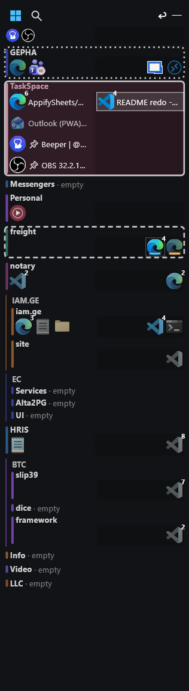</td>
    <td align="center">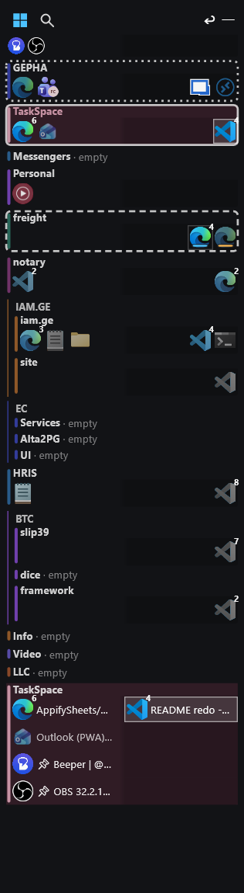</td>
  </tr>
  <tr>
    <td align="center"><em>Expand the current workspace</em></td>
    <td align="center"><em>Window list at the bottom of the bar</em></td>
  </tr>
</table>

<p align="center">
  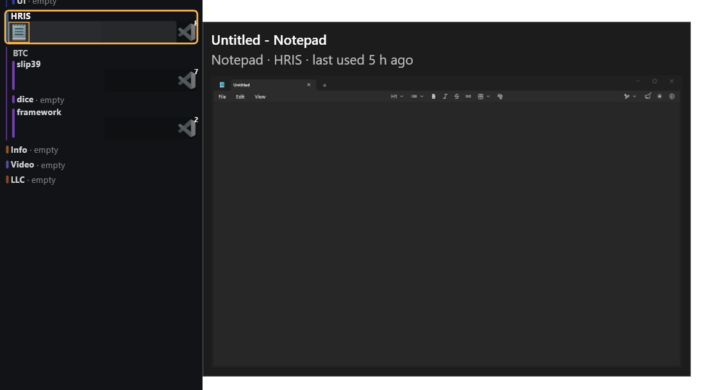
</p>

More in [The bar](docs/features/the-bar.md), and on the window list, pinned workspaces and the previous
workspace's item in [Strips and pinned workspaces](docs/features/strips.md).

### Screens

With more than one monitor, each row is divided into one lane per screen, in the order your
screens physically sit (left to right, then down to the next row of them), not in whatever order
Windows numbered them. The first screen's icons start at the left edge; later screens' icons are
pushed to the right, and the second screen's lane is shaded a little darker than the row, so free
space collects in the middle of the row where a click switches workspace. Every row splits at the
same place, so a position on the bar always means "which screen".

The shaded lane is also a **drop target**: drag an icon into the other screen's lane on its own
row and the window moves to that screen, sized proportionally the way `Win+Shift+Arrow` does and
never shrunk. Drop it into the other lane on another workspace's row and it changes workspace and
screen in one gesture. A minimised window moved this way stays minimised and comes up on the new
screen when you next open it. During any drag, a small readout beside the bar says what dropping
here would do: "move to Work, screen 2".

### Clicking, dragging, moving

- **Click an icon** to jump to that window wherever it lives. Click it again, once you are in
  it, to minimise it.
- **Click anywhere else on a row**, the gaps between icons included, to switch to that workspace.
- **Drag an icon to another row** to move the window there. Dragging a background window leaves
  you where you are; dragging the window you are in takes you with it, because sending away the
  thing you are using and staying behind is never what you meant.
- **Drag a window by its own title bar onto a row** and it moves there too, back to its original
  place and size (still maximised if it was). You stay put. Windows' Snap preview may flash while
  you drag; ignore it.
- **Drag either side edge to set the bar's width.** Icons re-wrap as you drag and the width is
  remembered. A busy row wraps onto another line rather than making the whole bar wider.
- **`Ctrl`+drag or middle-drag moves the bar**, from anywhere on it. Drop it within an icon's
  width of a screen edge and it snaps flush. It remembers a position for each monitor arrangement,
  the way Windows 11 does for windows.
- The bar grows and shrinks at its bottom edge; its top stays where you put it.
- **Right-click an icon** for the renaming items (below). **Right-click a row** for everything
  about that workspace. **Right-click empty bar** for the app-wide items: New workspace, docking,
  the Window list submenu, Minimize bar, Manage, Check for updates, any waiting update, and Exit.

<p align="center">
  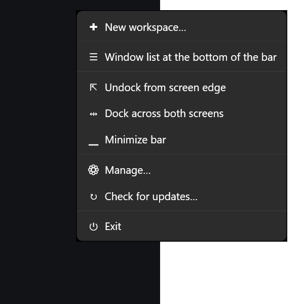
</p>

The bar does not appear in `Alt+Tab` or on the taskbar. It stays bright while you hold the chord,
drag an icon or have one of its menus open; otherwise it holds full strength for ten seconds after
the pointer leaves and then dims over four seconds to 35%. All four of those numbers are sliders
on Manage → Settings. A fully opaque setting means it never dims.

### The workspace row menu

Right-click a row for: **Rename…**; **Insert before…** and **Insert after…**;
the group items (next section); **Fold row**, which flips to **Unfold row**; **Pin to strip**, which
flips to **Unpin from strip**; the **Window list** submenu; the colour strip; **Delete workspace…**; and the bar items,
**Arrange workspaces**, where you drag rows to reorder or group them (it reads **Done arranging** while the mode is on), **Dock to screen edge**,
**Dock across both screens** and **Minimize bar**.

<p align="center">
  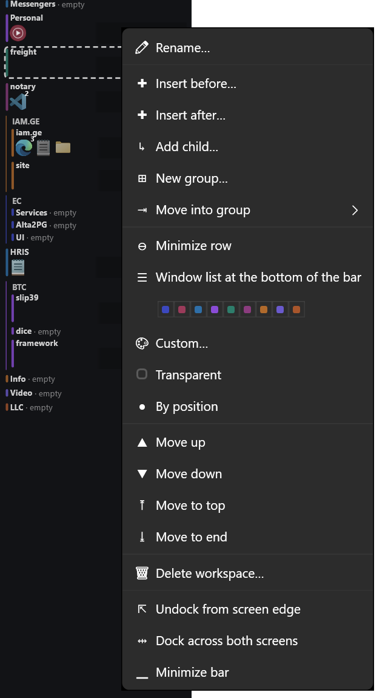
</p>

**Fold row** draws the row as its name alone, for a workspace you are not working in right now. The
name is followed by how many windows it holds, and by the amber attention dot when one of them is
flashing for you, so folding never hides a message. Clicking the name still switches there, and a
window dropped on it still moves there. The workspace you are on always shows its icons, folded or
not; leave it and it folds again.

**Tile windows** lays the workspace's windows out on each screen while you are on it,
starting from a grid. Turn it on with the tile button at the top of the bar, beside Search, or from
the row's menu; the gap between tiles is set on Manage. Drop a tile on the edge of another to put it
above, below or beside that one, which takes half of its room and leaves the rest alone, so two
tiles can sit side by side over a third that spans the screen. Drop it close to the screen's own
edge and it gets that whole side. Dropping on the middle of a tile swaps the two. Drag a separation
between two tiles to resize them. Where two separations cross, the drag moves only the part beside
the tile you hold, so the tiles across the crossing keep their size. The layout you make is kept,
across restarts too. Tick **Split Code windows last** on a VS Code icon's menu and a new window
leaves your three latest VS Code windows alone while any other tile can give it room.

More in [Tiling](docs/features/tiling.md).

**Colour.** Nine swatches sit in one strip inside the menu, with the current choice ringed. Below
them, **Custom…** opens Windows' own colour dialog starting on the row's current colour;
**Transparent** opts the row out of tinting; **By position** hands the colour back to the palette.
Palette colours follow *position*, so inserting a row above recolours the rows below it; picking a
colour pins it.

**Delete workspace…** asks first, and the dialog defaults to No. When the workspace still holds
windows it names the apps and closes them with it, the way their own close button would, nothing
killed; if an app refuses to close (an unsaved document, usually) nothing is deleted and it tells
you which one. The alternative, letting Windows delete the desktop, scatters those windows onto a
neighbouring desktop where you find them days later, so this app does not do that.

### Groups

Related workspaces can be grouped. A group has one caption, one colour settable from any of its
rows, and a line drawn down its left edge like a tree.

**New group…** on a row, or **Move into group** when groups already exist, makes a group: a name
and a box. Every group has a dim header row with its own menu (**Rename group…**, **Ungroup**,
**Fold group**, the colour strip, and **Move group up**, **Move group down**, **Move group to top**
and **Move group to end**, which move the whole group past the rows around it).

A row inside a group offers **Fold group '…'**, **Move out of group** and **Ungroup '…'**; the
last names the group because it affects rows other than the one you clicked.

**Fold group** draws the whole group as one line: its name, then each member's name, then how many
windows they hold between them and the attention dot if any of them wants you. Each name on the line
switches to that workspace. The workspace you are on keeps its full row under the line. A folded
group's line has the group's menu, which is where **Unfold group** is. Folding a group leaves each
member's own fold alone, so unfolding it puts every row back the way it was. Leaving a group of two dissolves it.
Ungrouping keeps every desktop, name and position.

### Arranging the bar

**Arrange workspaces**, on any row's menu, a group header's menu or the bar's own menu, lets you
reorder and group rows by dragging. `deskbar.cmd arrange on` and `arrange off` do the same from a
script. Neither works while the bar is minimized: restore it first. The pipe does not
bring the bar to the front, so `Esc` works only once the bar has focus. End the mode with `Esc`, with
**Done** on the strip at the bottom of the bar ("Drag rows to arrange · Esc"), or with **Done
arranging** on the menu.

More in [Arranging the bar](docs/features/arranging.md).

### Pinned, unnamed and unplaced rows

The **pinned row** sits at the top. Drop an icon on it to pin that window to every desktop so it
follows you everywhere; drag it off onto a workspace row to unpin it. Its caption line holds the
bar's header: **Start** and **Search** buttons on the left, and on the right **↩**, which goes
back to the workspace you were on before this one (the same thing one tap of `Win+Ctrl+Tab` does,
for when your hand is on the mouse), and a minimise button, which puts the bar away.

**Desktops you have not named** appear as their own rows below the workspaces, so nothing on your
machine is missing from the bar. Right-click one for **Name this desktop…**, which also renames it
in Task View so the two agree, or **New workspace…**.

An **Unplaced** row catches windows whose desktop Windows will not report, with a note saying why
each one could not be placed. Apps minimised to the tray do not fall into it; they keep their
workspace and reappear in it when reopened.

### Minimising the bar

**Minimize bar** is on every bar menu, on the tray menu, and behind the minimise button in the
bar's header. The bar goes
away and leaves a taskbar button that is pinned to every desktop; click it, or the tray item that
now reads **Show bar**, to bring the bar back. The X on that button's thumbnail restores the bar;
it does not exit. The state survives a restart.

### Docking

By default the bar floats wherever you drop it. Two other modes exist, both off by default and
both toggled from any bar menu, from the **Dock the bar to the edge of its screen** box in Manage,
or from the command line.

**Dock to screen edge** turns the bar into an app bar on the left or right edge of its screen,
full height with square corners. Windows reserves that strip: maximised windows, Snap and new
windows keep clear of it. The bar cannot be moved while docked (moving the strip would leave the
reservation behind), but its width can still be dragged. A full-screen window on its screen has the
bar step just behind it while it is in front. Minimising the bar gives the strip back.

<table align="center">
  <tr>
    <td align="center" valign="top">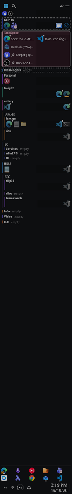</td>
    <td align="center" valign="top">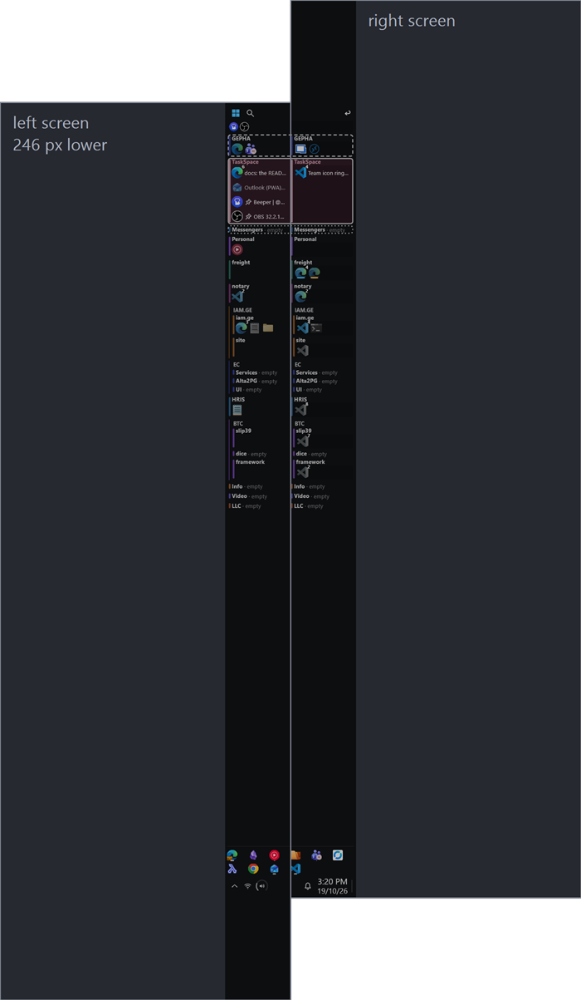</td>
  </tr>
  <tr>
    <td align="center"><em>Docked to one screen's edge</em></td>
    <td align="center"><em>Docked across both screens, which are not level</em></td>
  </tr>
</table>

Compare the floating bar at the top of this page: the same rows, but only as tall as its content,
with rounded corners, wherever you dropped it.

More in [Docking and taskbar pieces](docs/features/docking.md).

### Taskbar pieces

Docked or not, the bar carries enough of the taskbar that you can leave Windows' own on auto-hide.

<table align="center">
  <tr>
    <td align="center" valign="bottom">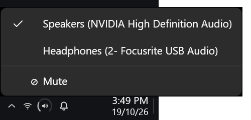</td>
    <td align="center" valign="bottom">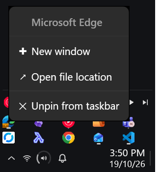</td>
  </tr>
  <tr>
    <td align="center"><em>The volume dial's device menu</em></td>
    <td align="center"><em>A pin's menu</em></td>
  </tr>
</table>

More in [Docking and taskbar pieces](docs/features/docking.md).

## Switching workspaces

Hold `Win+Ctrl` and tap `Tab` to walk your workspaces in **most-recently-used** order; release to
switch. Add `Shift` to walk backwards. One tap therefore returns you to wherever you just were,
however your list is arranged, which is the whole reason `Alt+Tab` is worth using. `Esc` cancels.

While you hold the chord, a short list appears beside the bar showing the walk in order, and on
the bar itself the row you would land on is ringed in amber, with the window that would take
focus there outlined. Nothing switches until you let go, so walking past three workspaces does
not animate three desktop switches.

<p align="center">
  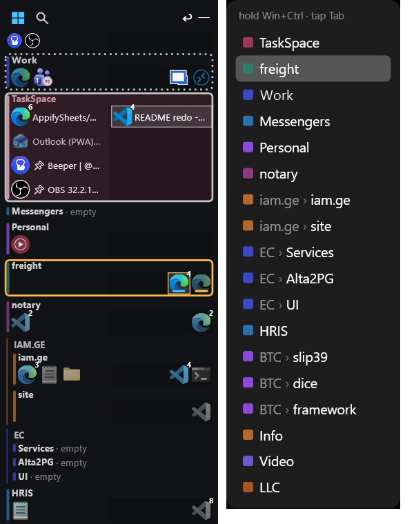
</p>

More in [Switching workspaces](docs/features/switching.md).

## Quick find

`Win+Alt+Space`, or the bar's **Search** button, opens a search box over everything open on every
workspace: window titles, every browser tab and every VS Code editor tab (open Claude Code
sessions included, since each is a tab named after the session). Type a few letters of anything
in the title, in any order: `inv 10` finds "Invoice 2026-10". Results sit under the workspace they are in, in its colour, the workspaces you
used most recently first. Enter takes you there, Esc closes the box. A browser window is listed by
its tabs, so you find the page, not the window that happens to show it. A tab is found by its own
title or its workspace, so `code` does not list every tab of every VS Code window.

More in [Quick find](docs/features/quick-find.md).

## Tasks

The bottom of the bar carries a short task list, for the things you want to remember while you work.
Type a note into the box at its top and press Enter (Shift+Enter starts a new line, which goes into
the note's description), and it lands on the workspace you are on (or on
none, or another one, by the chip under the box). The new note is selected and glows blue for a moment,
so you can see where it landed; the tasks panel's own add box does the same. To hand the note to Claude
straight away, press the play button after the flag toggles, or Ctrl+Enter, instead of Enter: the note is
added and "Start Claude on this" runs on it. Tick a note to close it,
with six seconds to undo.
An important task's title is bold and an urgent one's italic, which sorts the list into Covey's four
quadrants; set them from a line's right-click menu or the toggles in the tasks panel, and drag a line up
or down to reorder it. When there are more tasks than fit, the list scrolls with the mouse wheel.
Tasks waiting on you come first, but only three of them get a line (one on a floating bar): the rest fold into
one line, "+N more waiting on you", so your important tasks stay in sight right under it. Click that line to
open the tasks panel.
"+N more" (or "All tasks") opens the tasks panel,
with every task, its comments, and a Matrix view of the four quadrants side by side.
The panel is a full-height strip docked just inside the bar, on every virtual desktop, and it pushes
maximized windows aside as the bar does. A window that is not maximized but reaches under the panel when
it opens or grows is moved out from under it, keeping its size where there is room and narrowed where
there is not. Click the same button, or the x in the panel's toolbar, to close
it. Drag its inner edge to change the width (460 to start, 360 at the least, half the screen at the most);
Deskbar remembers the width and whether the panel was open. A search box (Ctrl+F; Esc or its x clears it) finds
tasks by every word you type, in titles, status lines and questions. Type a task's id, or a pull request's
number (`523`, `#523`, `PR 523`, `Deskbar #523` or its link), and it finds that task in every section, closed
ones included. A Claude session's `gh pr create` puts the new pull request on its task by itself, and the task
window lists them under "Pull requests". Tasks with a live Claude session sit in their
own "Claude working" group right under "Waiting on you": the ones whose session is working right now first, then
the idle ones, dimmer, under a dashed "idle" line. The "Claude | working | idle" switch next to the status chips
shows only the tasks with a live Claude session, only the working ones or only the idle ones, and stays on across
restarts, as "Current workspace" does. A chip or checkbox that is on is filled blue. The List is a grid: a header names the columns (Task,
Status, Sessions, Who, Age, Workspace), and dragging the line between two headers makes a column wider or
narrower, the title taking whatever is left; double-click that line to put the column back. Deskbar
remembers the widths. The buttons (the toggles, comments, Open Claude and the menu) sit together at the right
end of each line. Below 710 DIP wide the lines go slim, without the header: the title takes the whole line and the line's buttons sit at the end of its last
line, or under it when there is no room. The List and
Matrix switch appears from 780 DIP. A full-screen app makes the panel step back until you leave it.
A script can add and change tasks with `deskbar.cmd task`, and every Claude Code session keeps a task of
its own here: it joins the task its work continues or creates one, keeps a short status line on it, asks
you through it (the task waits on you, in orange, with the question, and the pull request or page it wants you to
open is a link you click right there in the tasks panel, which takes you to the task's workspace and opens it there; a question it puts to you in Claude Code's own
multiple-choice dialog waits on you the same way, until you answer it in the terminal) and marks it done when it has
finished: a done task gets a green tick (a hollow green ring while what it merged is not running yet, filling in once it is: for a change to Deskbar, once the copy you are running holds it; for a change to any other app, once the session reports the version it saw running in that app's logs or health page with `task deployed`, or you pick "Mark deployed" on the task's menu; under the questions, the done tasks with a full tick come first and the hollow rings after them), and every line in the tasks panel shows its status (a slim line in its tooltip). Only you close a task. Double-click a Claude task to go to its session, and pick "Start Claude
on this" on a note's menu to hand it to a new Claude session.

In the tasks panel the menu's actions are also small buttons on the line itself, before its "⋯": Edit, Open in
window, Add subtask, Assign to, Related to, Move to and Delete, as many as the panel's width has room for. Before
them every open task's line has one Claude button, a small spark: orange on a task that has a Claude session,
where it opens that session, and plain on a task that has none, where it starts Claude on it. "⋯" still has
them all.

A task can have subtasks, one level deep. Pick "Add subtask…" on a task's menu or its "+" button on the line, or
"Add subtask" in the row of buttons at the top of its open thread in the tasks panel when the line has no room for
it, and type a title in the box that opens right under it: that is all the brief it needs.
Enter opens the new subtask in the same place. A Claude session that takes up a subtask is told about its parent and the other subtasks,
with their status lines, your descriptions and comments, and every Claude session on them with the file its
conversation is kept in, so it reads what the earlier work found instead of you explaining it again. A subtask is
drawn right under its parent, starting with "↳", and a parent's line counts its open subtasks; opening a parent in
the tasks panel lists the ones without a line of their own (folded away, or hidden by a filter) as full lines, with
every button a task's line has; click one to open it right there, inside the parent's thread. Going the other way, an open subtask's thread starts with "↑ Subtask of" and its
parent's title, which you can click to show the parent, and "Open parent" on a subtask's menu (in the panel or on the
bar) does the same; a subtask's own window has a Parent button that opens the parent's window. Untick "Subtasks" at the top of the tasks panel to fold them into their parent's
line, in the panel and on the bar, which keeps the count; a subtask waiting on you stays in view. Drag a task onto the middle of another to put it
under that task; drop a subtask anywhere else, between two lines, to make it a plain task again. That holds for a subtask on a line of its own too (its parent snoozed or Claude's, or the subtask waiting on you); dropped back on its own line it stays as it is. In the tasks panel that works from the parent's open thread too: with Subtasks unticked a subtask is only listed there, and its entry drags out the same way. A parent closes last: while
any of its subtasks is open its tick will not close it, and its tooltip says how many are left.

A long task reads better in a window of its own. Pick "Open in window" on a task's menu (in the tasks panel or on
the bar), or the button at the top of its open thread, and the task opens in an ordinary window you can resize,
maximize and Alt+Tab to: the whole description with its links and pictures, the question or status line in full,
every comment with none cut short, its Claude sessions, its subtasks and its details. Edit (or F2) turns the title and
description into large boxes, with a Preview tab for the markdown; Ctrl+S or Ctrl+Enter saves and Esc cancels. Ctrl+Enter
posts a comment. Each task has one window, which opens on the desktop you are on, and every task window opens where you
last left one, at the size you gave it. A script opens one with `deskbar.cmd task open <id>`.

"Copy link" on a task's menu copies a link to the task, ready to paste into a pull request, an issue or a message.
Clicked, it opens the task in its own window on the PC where Deskbar runs; the link goes through deskbar.app, which
hands it to Deskbar, so the browser asks once whether to open Deskbar. Claude sessions put their task's link at the top
of every pull request, issue, mockup and page they make for it. A script gets the link with `deskbar.cmd task link <id>`.

Tasks can be linked. "Duplicate of…" on a task's menu in the tasks panel closes it as a duplicate of another task
you pick by typing part of its title, and the closed list says "Duplicate of" that task; "Related to…" links two
tasks, and both threads list the link. A note a Claude session leaves for later is linked to the session's task
the same way, so you can tell what it follows up. A Claude session looks for the same or related work before it starts, reads
what the linked tasks' sessions did, and closes its own task as a duplicate when the work is already done elsewhere.

A task you cannot do anything about yet can be snoozed. In the tasks panel, the moon beside a line's two toggles
(or "Snooze" on its menu) hides it for 1 hour, 3 hours, until 09:00 tomorrow or until 09:00 next Monday. A snoozed
task leaves the bar and the panel's lists and waits under the panel's "Snoozed" chip, which says when each one
comes back. It comes back by itself when the time is up, or sooner if its Claude session asks you something,
finishes, or its status changes, and "Wake now" brings it back at once. A task waiting on you can be snoozed too:
it leaves "Waiting on you" and comes back still waiting, with its question, unless the session asks something new
first, which brings it back at once. A script does the same with `deskbar.cmd task snooze <id> 2h` (or `tomorrow`, `monday`, `45m`, `3d`) and
`task wake <id>`.

The panel's Stats switch, next to List and Matrix, shows how the work is going: how many tasks are open,
how many were added and finished in the last 7 days, and the median time from added to finished. Under
the numbers are two charts covering up to two weeks. One shows the tasks still open at the end of each
day, which is what a burndown would draw. The other shows the tasks added and finished each day. Click a
day to list what was finished and added on it. Click a task in that list to go straight to it in the
panel, closed tasks included. "Finished" means Done or closed. Stats counts every task, whatever the
filters say. A script gets the same numbers as JSON with `deskbar.cmd task stats` (`--days 30` for a
longer stretch), and `deskbar.cmd tasks-window stats` opens the panel on Stats.

The Manager button on the bar opens one background Claude session a day, on the Fable model, that looks after the
whole board. It reads `deskbar.cmd task overview`, which prints one line per open task, and acts only through
`deskbar.cmd task` commands: it can comment on a task, which wakes an idle session, and it can pass your words to a
task that is waiting on you. It cannot close, delete or finish a task, and only what you say after "The user says:"
counts as you. Click again to bring its window forward; the next day a click ends yesterday's and starts a new one.
`deskbar.cmd task show <id>` prints one task in full and `deskbar.cmd task manager` does what the button does.

On a day you have opened it, Deskbar also wakes the manager when a Claude task is handed back to you because its
session stopped without asking or finishing. It is woken at most once every half hour, never in the middle of a turn,
and never for a question: every task's question is already on the bar. On a wake it nudges each stopped session once
with a comment. It does not repeat what the bar already shows, such as a task's question or a pull request to merge;
it tells you only what no single task shows, like two sessions doing the same work or one decision holding up several
tasks. A dot on the Manager button means a session stopped again after its nudge; opening the manager clears it.

When the manager needs a decision from you, its question shows as a violet line at the top of the bar's task list and
of the tasks panel, above every task's question. Click it to open the manager; your reply clears it.

The manager starts with Claude Code's Remote Control on, so it shows up as "Deskbar manager" in the Claude app on your
phone and you can talk to it from there, with the keyboard's microphone if you like. It is the only one: the sessions
Deskbar starts on tasks keep Remote Control off, whatever your Claude Code settings say, so the phone's list is not
buried under them. A session that already had Remote Control keeps it when it is resumed.

The manager's window is docked: it sits in a full-height column just inside the tasks panel (just inside the bar while
the panel is closed), and maximized and snapped windows keep clear of it, as they do of the panel. It is pinned to every
desktop, so it is there whichever workspace you are on. Drag its inner edge to make it wider or narrower; Deskbar
remembers the width. Dragged by its title bar, it goes back to its place. Closing it gives the space back. It carries
Claude's icon in violet instead of the plain one every task session has, a violet ring while it has focus, and its icon
glows while the manager's question waits on you.

The tasks screencast shows the old floating window and needs filming again for the panel.

More in [Tasks](docs/features/tasks.md).

## Goals

Weekly and monthly goals, after Covey's weekly planning: pick the few things that matter this week or
this month, and let the tasks serve them. A task can belong to a goal, from its "..." menu in the tasks
panel. The tasks panel can filter by goal, and a task's tooltip on the bar names its goal. For now
goals are added and changed with `deskbar.cmd goal`, and `goal list` shows how many of each goal's
tasks are done (a monthly goal also counts the weekly goals that belong to it). A planner window is
coming.

More in [Goals](docs/features/goals.md).

## Naming windows

Give a window a short name so the taskbar shows `RDP` instead of
`Remote Desktop Manager [server-01 - fhd]`. Right-click an icon on the bar for the renaming items.

<p align="center">
  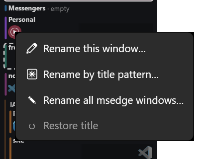
</p>

More in [Naming windows](docs/features/naming-windows.md).

## Where windows go

Deskbar never launches anything, and it moves or resizes a window on screen only when you ask:
by dropping it on another screen's lane, or by turning on [tiling](#the-workspace-row-menu) for a workspace.
The axis it arranges on its own is which desktop a window belongs to, and that it remembers.

More in [Where windows go](docs/features/where-windows-go.md).

## Manage

Left-click the tray icon. Four tabs, and Manage opens on the first: **Settings**, which holds
every setting and applies each one as you change it, **Shortcuts**, **Time** and **Deskbar Pro**.
Workspaces and rules are not managed here; the bar and its menus do that.

<p align="center">
  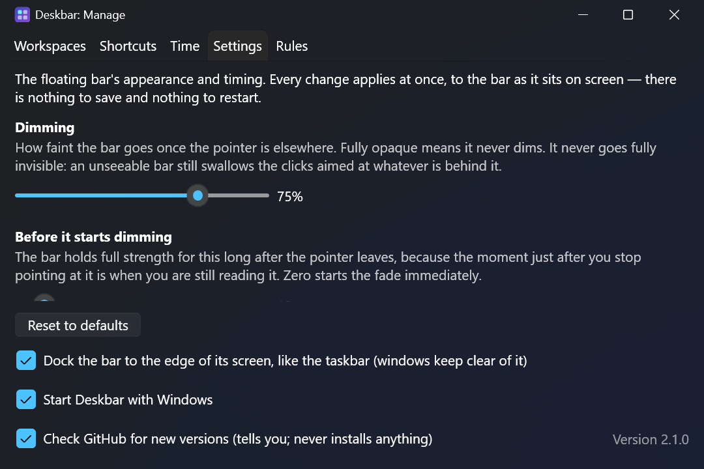
</p>
<p align="center">
  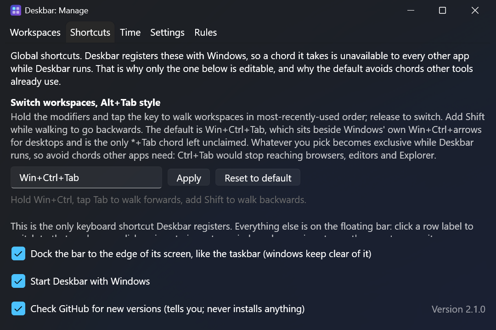
</p>

More in [Manage](docs/features/manage.md).

## Updates

Every five minutes Deskbar asks GitHub whether a newer release exists (a release whose exe is
still being built is ignored until it is ready). When one appears you are asked once, in a small
window of the app's own: "Update Deskbar to 1.28.0?". Say no and an **Update to …** item stays
on the tray and bar menus until you are on that version. Only the newest offer is ever shown.

More in [Updates](docs/features/updates.md).

## Reporting a problem

**Report a problem…** on the tray menu and the bar's menu opens a small window: say what happened,
paste screenshots with Ctrl+V (Win+Shift+S works well) or drop image files on it, up to five, and
press Send. Nobody needs an account or a sign-in.

More in [Reporting a problem](docs/features/reporting-a-problem.md).

## Driving it from scripts

While Deskbar runs it keeps a small batch file at `%APPDATA%\Deskbar\deskbar.cmd` that
hands a command to the running copy. A coding agent that has just set up a git worktree can give
it a workspace of its own and move the editor there:

```powershell
& "$env:APPDATA\Deskbar\deskbar.cmd" move wt-login --create --group EC --title wt-login --wait 20
```

Everything the bar's menus do has a command, and each one runs the same code as its menu item.
`help` prints the list from the running copy, so it always matches the version you have.

More in [Driving it from scripts](docs/features/scripts.md), with the full list of commands.

### Claude Code

When Claude Code is installed (there is a `.claude` folder in your profile), Deskbar keeps a skill at
`%USERPROFILE%\.claude\skills\deskbar\SKILL.md`. Every Claude Code session on the machine then knows
to open links with `open`, start programs with `start` and move the windows it opens with
`move --no-follow`, so they land in the session's own workspace instead of on the one you are
looking at. The file is rewritten when Deskbar updates.

It also adds two hooks to `%USERPROFILE%\.claude\settings.json`, beside any you have: when a session
finishes a reply or waits for a permission while you are on another workspace, that workspace's name
and colour rail flash orange on the bar and the session's VS Code icon glows. When you go there, that
window's border blinks orange for five seconds, or until you click or type in it. The
hooks run `%APPDATA%\Deskbar\claude-hook.cmd`, which hands the hook's details to `deskbar.cmd claude-hook`
and always exits 0. When Deskbar is not running, the hook prints nothing and the session carries on.

With **Claude Code sessions keep their tasks in the task list** ticked under it (on by default), the Stop hook also
nudges a session whose turn ends with its task still in progress and nothing of its own running in the
background: once per reply, it tells the session to run `task ask` if the next move is yours, so the task
comes to you with a question instead of sitting out of sight. Three more
hooks, on SessionStart, UserPromptSubmit and SessionEnd, run `claude-task-hook.cmd`. A starting session
is told its task, or the open tasks on its workspace it could join and how to create its own; each of
your messages reminds it of its task in one line. Your message changes no status: the session says when your
reply settled its question, and puts a done task back in progress only when your message gives it more work. Sessions run
with `claude -p` or the Agent SDK are left out. `deskbar.cmd claude-tasks off` turns this off.

While it is on, Deskbar also reads Claude Code's own list of running sessions (`claude agents --json`)
every 15 seconds. A session no task knows, still running after two minutes, gets a task of its own, on the
workspace of the VS Code window showing its folder (or, with no such window, where the latest task in its repo went), once its hooks have said someone is at it (so `claude -p`
runs stay off the board); if it later joins a task of its own, the one Deskbar made
goes away again unless you have changed it (renamed, moved, flagged, linked to a goal, set its status,
assigned it, described it or commented on it). When the session of an open task is no longer running, after a reboot, a crash or a
closed VS Code window, Deskbar resumes it in the background with `claude --bg --resume`, one session every
five seconds, and says so in the task's thread; a session whose last turn was cut off is told to continue,
and one you stopped with Esc is not. Deskbar waits two minutes first: nothing is resumed in the first two
minutes after it starts, and a session must have been gone for two minutes, because VS Code brings its own
sessions back by itself after a restart or a window reload. After a reboot that means the sessions come back
two minutes after Deskbar next starts. A session you cleared with `/clear` is not resumed; the new one takes
its place on the task.
A session whose turn died on your Claude usage limit is shown as stopped: its task's thread and status line say
so and name the time the limit resets. Deskbar resumes it a couple of minutes after that time and tells it to
continue, also when Claude Code still lists it, as long as it runs in the background and no Deskbar window is
open on it. A session in a VS Code panel or a terminal cannot be restarted from outside, so you type in it. A
comment on such a task reaches the session straight away, even before the limit resets. The same goes for a
session Claude Code still lists after its process has ended: a comment stops and resumes it with the comment,
instead of leaving it in an inbox nothing reads.
A session that keeps stopping straight after being woken, whose transcript Claude Code no longer keeps, or
whose resume fails (Claude's message goes into the thread), is left alone and its task waits on you with the
reason until you act on it: set its status and it tries again, or double-click it to bring the session back
and clear the give-up. Marking a task done lets its session go: once a done or closed task's background
session has sat idle for a minute, Deskbar stops it with `claude stop`, which keeps the conversation, and says so
in the thread. A session asking for your answer, any open task's session, a VS Code session and one you have
Deskbar's window open on all keep running. Double-click the task to bring the session back. When Claude Code's list cannot be read
(`claude` missing from the PATH, say), Manage says why under the resume box. **Resume the sessions of open
tasks after a restart or a crash**, under the tasks box, turns the resuming off and leaves the rest on
(`deskbar.cmd claude-resume off`). Claude Code keeps sessions for 30 days; raise `cleanupPeriodDays` in
`~/.claude/settings.json` to keep them longer.

The same list says whether each session is working or idle. When no session has worked on a Claude task
for 15 minutes, Deskbar first asks its session what the task is waiting on. If the next move is yours, the
session asks you, and the task shows under Waiting on you. If it is waiting on something else, like a CI run,
a background job or another session, it says so in its status line and the task stays with Claude. Only a
session that says nothing within 5 minutes, or one Deskbar cannot reach, has its task handed back to you. It
then shows on the bar with Claude's last status line, so a session that stopped with "ready to merge" without
asking you is not left out of sight. It goes back to Claude by itself once its session works on it again. A
task you assign to yourself stays yours.

Double-click a task, on the bar or in the tasks panel, to go to its session. You land on the task's
workspace, and a background session's Windows Terminal window comes to the front, or opens attached to it
(`claude attach`) when none is open; an ended session is resumed first. A VS Code session's window comes to
the front instead. "Open Claude", right after Edit on a Claude task's menu, does the same without the first
click, which would open the task in the tasks panel, and so does the Open Claude button on a Claude
task's line in the tasks panel. "Start Claude on this", in the same place on the menu of a task no session
has worked on and as a button in an open task's thread, starts a background session with the task as its
first message, in the task's folder or one you pick, and opens a window on it. A menu has one of the two,
never both: a task Claude already has gets "Open Claude". An open thread follows the same rule in its row of
buttons: "Open Claude" while the task has a session to go to, which resumes an ended one, and "Start Claude on
this" only for a task without a session or one whose session has expired. For a fresh session beside an ended
one, use the start button in the task's own window ("Open in window"). A folder Claude Code was
never told to trust puts Claude's message in the thread and offers a terminal there so you can accept the
trust prompt yourself. A task's thread lists its sessions, newest first, as working, idle, ended or expired,
each but the expired ones with Open. `deskbar.cmd task go|start|open-session` do the same from a script.
When a Claude task looks stale, say it still asks you to merge a pull request you merged an hour ago, press
Reevaluate. The task's session wakes up (an idle or ended one too, the way a comment reaches it), checks where the
task really stands with gh and git, and puts right what is out of date: it settles a question that is already
answered, marks finished work done and rewrites an old status line. The button sits on the line of every Claude
task waiting on you (its last button, on a wide panel) and in its open thread, and "Reevaluate" is on the menu of
every Claude task. `deskbar.cmd task reevaluate <id>` does the same from a script.
Every session Deskbar starts on a task names its model, so it does not follow whatever model your Claude Code
settings hold that day: Opus until you choose another with `deskbar.cmd claude-model <name>` (an alias such as
`sonnet` or `fable`, or a model's full name; without a name it says what is set), and
`deskbar.cmd task start <id> --model <name>` picks one for a single session. A session keeps the model it
started with when it is resumed. The briefing each task session gets also tells it to hand test runs, searches
and rebases to a subagent on a cheaper model, and to have its strongest model review the diff before it opens
a pull request.
The window opens in Deskbar's own "Deskbar Claude" Windows Terminal profile (Dark Modern colours, Claude's
colours and bold text as Claude draws them, installed while the tasks box is ticked and removed when either
Claude box is unticked), and closing it leaves the
session running. On the bar the window carries Claude's icon, read from `claude.exe`, instead of the terminal's.
Where Windows Terminal is not installed, as on Windows Server 2022, these windows open as plain console
windows running `claude.exe`, with the same title, so they are found again the same way. This needs the Claude
Code CLI's `claude.exe`, which Deskbar finds on the PATH (as the
registry has it now, so an install made while Deskbar runs counts) or in the native installer's
`%USERPROFILE%\.local\bin`. An npm install alone is not enough, since it has no `claude.exe`. When "Start Claude on
this" finds no `claude.exe`, Deskbar offers to install Claude Code: Yes opens a terminal in the chosen folder that runs
Claude Code's official installer (`https://claude.ai/install.ps1`) and then `claude`, so you sign in and trust the
folder there, and "Start Claude on this" works after that. A start or a window that fails for any other reason says so
in a message box as well as in the thread.

The first time Deskbar changes `settings.json` it keeps the original as `settings.json.deskbar-backup`,
and it leaves a file with comments in it alone.

More in [Claude Code sessions](docs/features/claude-sessions.md).

## Why this matters

Switching between projects is expensive, and the expensive part is not the switch. It is
**rebuilding the context you had before**. Here is what the research says about that, including
the parts that argue against this app.

### The unit people think in is the project, not the window

[González and Mark](https://dl.acm.org/doi/10.1145/985692.985707) followed analysts, developers
and managers through their working days and found that people organise work into **"working
spheres"**: thematically connected units, each with its own documents, tools and people. Workers
spent roughly **three minutes on a single event** before switching, and a little over two minutes
on any one document or tool.

A taskbar shows you windows. Your head is organised by spheres. That mismatch is the gap. Mark's
later work found the fragmentation getting finer still: average time on a single screen fell from
about **2.5 minutes in 2004 to roughly 47 seconds**.

### Resuming is the costly half, and it is mostly searching

The most directly relevant study is
[Parnin and Rugaber's](https://link.springer.com/article/10.1007/s11219-010-9104-9) analysis of
**10,000 recorded programming sessions from 86 developers**, plus a survey of 414 more. Two numbers
stand out:

- only **10%** of sessions resume programming activity within a minute of an interruption;
- only **7%** involve *no* navigation to other locations before editing resumes.

After a switch, most of the time goes on re-finding things rather than doing the work. That is the
cost a workspace tool can attack.

### Your windows are external memory, not clutter

The same study names the strategy developers invent for themselves, **cue priming**: deliberately
leaving the last edited window open, or highlighting the relevant lines, so that returning to the
task triggers recall.

This is the crux of the argument. **A window arrangement is externalised mental state.** Every
open window is a deliberate cue about where you were. Anything that scatters the arrangement
destroys the cue, and anything that preserves it preserves the context for free. Deskbar does
not help you rebuild context; it stops the context being demolished.

Which is why, left to itself, it never changes a window's size or where it sits on screen, and it
opens nothing for you. It arranges your windows along one axis only, which desktop each belongs to,
and that much it remembers and puts back. Tiling is there for a workspace where you want it, but
you turn it on, and the layout you make is kept, so it becomes part of the arrangement rather than
something that scatters it.

### Which is what virtual desktops were invented for, in 1986

[Henderson and Card](https://dl.acm.org/doi/10.1145/24054.24056) built *Rooms* at Xerox PARC to
attack what they named **"window thrashing"**: the state where the screen is too small for the
work, so the user "must expend considerable effort to keep desired windows visible". Their fix was
multiple virtual workspaces, exploiting the fact that window access clusters by task.

Forty years on, Windows ships virtual desktops that solve the *space* problem and barely touch the
*context* problem: no visible names, no memory of what belongs where, and nothing survives a
reboot. Existing tools each cover a slice (PowerToys Workspaces relaunches layouts, Groupy tabs
windows, TaskbarGroups groups shortcuts), but none does *live context switching with persistence*.

### Attention residue: why unfinished work keeps charging you

[Leroy](https://ideas.repec.org/a/eee/jobhdp/v109y2009i2p168-181.html) found that when people
switch tasks, part of their attention stays with the previous one, and they perform measurably
worse on the new task as a result. The effect is strongest when the previous task was
**unfinished**, time-pressured or emotionally engaging, and it does not fade after a moment's
adjustment.

Fifteen taskbar buttons from four projects are fifteen reminders of things you have not finished.
Stated plainly: Leroy studied cognitive residue, not taskbars. That visible unfinished work
sustains residue is a reasonable inference, not a measured finding.

### How that maps onto what the app does

| The research says | What Deskbar does |
|---|---|
| Work is organised in *spheres*, not windows | Workspaces are named, first-class things you switch between |
| Only 10% of resumptions are fast; the rest are re-finding | A switch restores an entire context at once, with nothing to re-find |
| People leave windows open as recall cues | The cue *is* the workspace, preserved and persisted |
| Window thrashing wastes effort keeping the right windows visible | Other contexts' windows are on another desktop, natively filtered out of the taskbar |
| Unfinished work stays costly while it is in view | Other projects are out of sight, not merely minimised |
| Fragmentation is getting finer | A switch is `Win+Ctrl+Tab`, or one click on the bar |

And the features that exist because manual organisation decays the moment it needs upkeep:
**placement memory** (for the apps you choose, where you last put a window is where it goes next
time, keyed to what the app *is* rather than to a window handle), **rosters** (a workspace remembers which apps belong to
it even when they are closed, which is what makes that memory outlive any single window), and
**renaming** (`RDP` is parsed faster than `Remote Desktop Manager [server-01 - fhd]`, and
retrieval cues work better when they are legible).

### Agentic AI multiplies the contexts, it does not replace them

One thing has changed the shape of a working day faster than any of the research above
anticipated. Supervising coding agents is not one task in one editor. Each agent you have running
wants its own editor window, its own terminal, its own browser tabs, often its own running copy of
the thing under test, and each of those clusters is a context you step into while another agent
works and step out of when it needs you. The agent does the typing; the supervising, reviewing
and deciding still happen in your head, and they happen **several times over, concurrently**.

That is the same working-sphere problem as before, at a count nobody used to reach. Three projects
on the go was a busy day; three agents on one project plus two on another is an ordinary
afternoon, and the windows do not stay tidy on their own. Virtual desktops are the right container
for it, one per line of work, which is why this app puts effort where that count starts to hurt:
every desktop's windows visible at once, most-recently-used switching for the two you are
alternating between, groups for related lines of work, memory of where each window belongs so a
restart does not scatter them, and a command line so the agent can set up its own workspace.

### Who it is for, and who it is not

The benefit scales with **how many unrelated contexts you hold at once**, not with how hard you
work: several projects with distinct toolchains, switching on someone else's schedule, work and
personal life on one machine, contexts that live for days.

If you work on one thing at a time and close it when you are done, this solves a problem you do
not have.

### Where the argument is weak

1. **Cheaper switching is not less switching.** The research suggests *frequency* drives the
   stress. This lowers the cost per switch and may even encourage more of them.
2. **No study measures Deskbar.** Everything above is adjacent research on interruption,
   resumption and window management; the step from "resumption is mostly re-finding" to
   "therefore this helps" is mechanism-level reasoning, not evidence about this product.
3. **Windows already provides the mechanism.** The claim is not that this invents context
   isolation, only that it makes it nameable, persistent and automatic.
4. **The AI argument is an observation, not a finding.** Every other claim above rests on a
   published study. That one rests on how this app's own author works, and it is new enough that
   nobody has measured it. Read it as a description of a workload, not as evidence.

### Sources

- Victor M. González and Gloria Mark, ["Constant, constant, multi-tasking craziness": Managing multiple working spheres](https://dl.acm.org/doi/10.1145/985692.985707), CHI 2004. Working spheres, and the ~3-minutes-per-event figure.
- Gloria Mark, Victor M. González and Justin Harris, [No Task Left Behind? Examining the Nature of Fragmented Work](https://ics.uci.edu/~gmark/CHI2005.pdf), CHI 2005. The fragmentation of knowledge work.
- Gloria Mark, *Attention Span* (Hanover Square Press, 2023). The 2.5-minutes-to-47-seconds figure.
- Chris Parnin and Spencer Rugaber, [Resumption strategies for interrupted programming tasks](https://link.springer.com/article/10.1007/s11219-010-9104-9), Software Quality Journal 19(1), 2011 ([PDF](http://www.chrisparnin.me/pdf/parnin-sqj11.pdf)). The 10% and 7% resumption figures, and cue priming.
- D. Austin Henderson and Stuart K. Card, [Rooms: the use of multiple virtual workspaces to reduce space contention in a window-based graphical user interface](https://dl.acm.org/doi/10.1145/24054.24056), ACM Transactions on Graphics 5(3), 1986 ([PDF](http://rivcons.com/wp-content/uploads/1987/Rooms-TOG.pdf)). Window thrashing.
- Sophie Leroy, [Why is it so hard to do my work? The challenge of attention residue when switching between work tasks](https://ideas.repec.org/a/eee/jobhdp/v109y2009i2p168-181.html), Organizational Behavior and Human Decision Processes 109(2), 2009. Attention residue.

## How it works

- Each workspace is backed by a real Windows virtual desktop, so taskbar filtering is native, with
  no shell hacks, and a crash can never lose a window. Hiding windows with `ShowWindow` was
  considered and rejected for exactly that reason: a hidden window can be orphaned by a crash, a
  window on a virtual desktop cannot.
- The bar is an ordinary top-level window that reclaims "always on top" on every foreground
  change and once a second, because the taskbar and the Start menu are topmost windows too and a
  second click on the taskbar changes no foreground window.
- Window lifecycle comes from WinEvent hooks, with a five-second sweep that repairs what the hooks
  drop under load. Those events can only ever lose windows, never invent them, so the sweep
  checks the real window handles rather than trusting the list.
- Where a window belongs is remembered by **what it is**, not by its window handle: executable
  path plus arguments, with Chromium's `--profile-directory` and `--app-id` folded in so an
  installed web app is not its browser. Firefox is deliberately not keyed by profile, because it
  has no profile flag and every window would collapse into one identity.
- The ordinal colour band keys on a hash of the icon's pixels. Process name, the command line's
  app id and the window's AppUserModelID were each tried first and each measured wrong on real
  windows; the picture is the one thing two identical-looking windows reliably share.
- Tab counts come from UI Automation on a background thread, refreshed at most every four seconds
  unless the title changed.
- Docking uses the shell's app bar registration (`SHAppBarMessage`), the same mechanism the taskbar
  uses to reserve its strip.
- The volume dial talks to Core Audio; choosing a playback device goes through the undocumented
  `IPolicyConfig`, which is the only way to set Windows' default device from a program. The pins
  line reads the taskbar's own pinned list from the registry and never writes it.
- **Other programs ask the running copy rather than touching anything themselves.** The app owns
  `state.json`, the virtual desktops and the window list, so a second process editing any of them
  would race it. It listens on a named pipe only your own Windows account can open, per session;
  `deskbar.cmd`, or the exe started with `ctl`, sends one command and prints the answer.
  Commands run on the app's UI thread through the same code the bar's menus use.
- Everything is persisted, so your workspaces, groups, window names, colours, icon order, the
  bar's width, position and settings, and your shortcut survive both an app restart and a reboot.

### Diagnostics

Three traces (clicks, row geometry, icon sources) sit behind one switch: create the empty marker
file `%APPDATA%\Deskbar\trace.on` (or set `DESKBAR_TRACE=1`) and restart. The log is
`%TEMP%\deskbar-trace.log`, appended across restarts; its first line names which switch turned
it on. The geometry and icon traces write only when their output changes, so the file stays
readable with tracing left on all day. Off by default, and off means nothing touches disk.

## Licence

The source is available under the [PolyForm Strict License 1.0.0](LICENSE): you may read
it, build it and run it for noncommercial purposes, and you may not distribute it or
publish changed versions. Using Deskbar for work is commercial use, and [Deskbar Pro](#deskbar-pro) is the
licence for it. Contributions are welcome under the extra permission in
[CONTRIBUTING.md](CONTRIBUTING.md). This is source-available software, not open source.

## Tech

C# / .NET 10, WPF tray application (Fluent theming, follows your system light and dark mode),
the Windows virtual desktop COM API via Slions.VirtualDesktop, WinEvent hooks plus System.Reactive
for window lifecycle, H.NotifyIcon for the tray, UI Automation for tab counts, Core Audio for the
volume dial, WinRT `Windows.Media.Control` for now-playing, and CSharpFunctionalExtensions for
railway-style error handling.

The domain is deliberately COM-free and heavily unit-tested: about a thousand test methods across
two projects, the great majority in `Deskbar.Core.Tests` and running without touching Windows
at all. Most of the rest construct real WPF windows on an STA thread per test. Nine carry
`Category=Integration`: they create, switch and delete real virtual desktops, activate real
windows, or call github.com, and they are excluded from the routine run below.

## Development

```powershell
dotnet build Deskbar.sln
dotnet test Deskbar.sln --filter "Category!=Integration"
```

The `Category=Integration` tests are excluded from that command on purpose: they create, switch
and delete **real** virtual desktops on the machine running them. Run them deliberately, not
while you are working.

If Deskbar is running on the machine, run the tests on a hidden desktop instead:

```powershell
pwsh scripts/test-hidden.ps1
```

The window tests open hundreds of real windows, and a running Deskbar treats them like any
others: in a tiled workspace it tiles each one and rearranges your windows around it. The script
builds on your desktop, then runs `dotnet test --no-build` on a separate Win32 desktop that
Deskbar cannot see and that never reaches your screen. Each run gets a desktop of its own with a
small 8 MB heap, and nothing started on it outlives the run, so test runs, even several at once,
cannot use up the memory your own desktop needs to create windows. Before it starts, the script
checks that every processor can still register window classes and repairs it if not
(`scripts/user-atoms.ps1`, which you can also run by hand when programs start failing with "Not
enough memory resources"). The four `Category=Screen` tests read real pixels, windows or monitors, which a hidden
desktop does not have, so the script leaves them out; CI runs them. Run on your own desktop
beside a live Deskbar, the window tests refuse to start and say so.

To try a Debug build without touching your real settings, set the environment variable
`DESKBAR_APPDATA` to a scratch folder, given as a full path (a relative one is ignored). Deskbar
then reads and writes under that folder instead of `%APPDATA%`. Leave "Start with Windows" alone
in a Debug build run under the override, since that checkbox still writes the real value. Set the
variable in the shell you start the build from (`$env:DESKBAR_APPDATA = 'C:\scratch\deskbar'` in
PowerShell), not with `setx`: setx makes it permanent for every Deskbar started afterwards, a real
one at login included, and does not reach a shell that is already open. Only one copy runs at a
time, override or not, so exit the running Deskbar from its tray icon before starting the Debug
build.

### Releasing

Releases are signed with a code signing certificate whose key lives on a hardware token, so
the last steps happen on one machine and not in CI.

Before the first signed release:

- `gh` is installed and authenticated with write access to the repository.
- signtool from the Windows SDK is installed, or `$env:SIGNTOOL` points at one.
- The certificate's USB token and its driver are set up, with the certificate in
  `Cert:\CurrentUser\My`. The thumbprint is the certificate's Thumbprint in
  `Get-ChildItem Cert:\CurrentUser\My -CodeSigningCert`.
- Enforcement is switched on with `gh variable set SIGNING_CERT_THUMBPRINT --body <thumbprint>`.
  Renewing the certificate changes the thumbprint, so update the variable before the next
  release, or every release reverts.
- One rehearsal. The version cannot be chosen any more (git computes it), so a rehearsal is a
  real release from `main`: run the workflow by hand (`gh workflow run Release`), mark the
  draft a prerelease (`gh release edit vX --prerelease`) so it never becomes latest, sign and
  publish it with the script, and confirm the guard passes. For the second half, build another
  draft the same way, mark it a prerelease, publish it unsigned by hand and confirm the guard
  reverts it. Delete both with `gh release delete vX --yes --cleanup-tag`.

1. Write the pull request as usual, with a `## Release notes` section in its description,
   written for the people updating: the release that ships the change puts that section, up to
   the next `##` heading, in its notes, beside the sections of every other pull request it
   ships. Nothing is bumped and the title carries no version: each release is numbered one
   above the previous release of `version.json`'s `major.minor` (2.5.432, then 2.5.433), by the
   Release workflow, in its own copy of `version.json` (`scripts/ReleaseVersion.psm1`). A build
   on your machine is `major.minor.<git height>` and its patch says nothing about the release
   numbers. Label the pull request
   `no-release` when the change must not ship on its own yet; it then goes out with the next
   release. Label it `critical-update` when the fix should not wait: copies of Deskbar offer an
   ordinary release at most once a day, and a critical one at once. The release then says so in
   its notes and carries a hidden marker every later release copies forward, so a copy several
   releases behind still sees it (`scripts/ReleaseNotes.psm1`). A minor bump (2.5.0) is a pull
   request that edits `version.json`.
2. Merge it. A merge that changes something under `src/` starts the Release workflow by itself;
   any other merge starts nothing. The workflow looks at everything merged since the last
   published release. It skips quietly when the merged commit is already in a release, or when
   every change under `src/` since then is labelled `no-release`. Otherwise it numbers the merge
   one above the last release, builds it and creates release `vx.y.z` with an unsigned exe, named
   `Deskbar-x.y.z-win-x64.exe`, whose notes collect the `## Release notes` sections of every pull
   request since the last release. Several merges close together release ONCE, from the newest:
   a newer merge cancels the build still running for an older one, and the newer release's notes
   name the older pull requests too, so nothing is lost, and the next number goes to the release
   that does go out. The
   build also skips the tests when CI already passed them on the exact commit that was merged.
   To build by hand instead, for example to retry a failed run, open Actions, pick
   Release and choose Run workflow on `main` (there is no input): it numbers `main`'s head one
   above the last release, refuses a commit that already has a release, and always stops at a
   draft.
   A build from any other branch is `x.y.z+<hash>` and not a release; the workflow refuses it.
3. On the signing machine, with the token plugged in, run
   `scripts/sign-release.ps1 -Tag vx.y.z -Thumbprint <thumbprint>`, for 2.0.0
   `scripts/sign-release.ps1 -Tag v2.0.0 -Thumbprint <thumbprint>`. The token's driver
   prompts for its PIN. The script signs, verifies, uploads and publishes. `-TimestampUrl`
   overrides the timestamp server, and `-NoPublish` uploads the signed exe and leaves the
   release a draft. If an upload or the publish fails, the script keeps the signed files and
   prints where they are and how to finish.
4. The guard job in the Release workflow runs when the release is published. It checks the
   published assets and reverts the release to a draft if anything is unsigned, or if no
   executable is attached.

After a revert the release is a draft again: fix the cause and re-run the script.

Until the certificate exists, the repository variable `SIGNING_CERT_THUMBPRINT` is unset and
step 3 does not happen: the workflow run that the merge started publishes the release itself,
after checking that an executable is attached (the guard does not run for a release the
workflow publishes with its own token, so that check is made there instead). A draft built by
hand is published with `gh release edit vx.y.z --draft=false`, and the guard then only checks
that an executable is attached. Setting the variable switches signing enforcement on, and a
merge's release then waits as a draft for step 3.

GitHub runs a release event from the workflow file at the tag's commit, so the guard only
covers releases whose tag's commit carries this workflow. Never re-publish a release whose
commit does not, which includes every release made before the guard existed: that commit's
own workflow runs instead, rebuilds the exe and replaces the release's asset with an
unsigned one, and nothing reverts it.

The release build also packs `Deskbar-<version>-store.msix` and keeps it as a workflow
artifact, not a release asset. The `store-smoke` job installs that package on the runner and
checks that `deskbar version` answers from it.

The Store submission workflow (`store-submit.yml`) then sends the package to Partner Center. It
runs after every release, once a day, and by hand from the Actions tab (with a dry-run switch).
Each time, it takes the newest package from a successful release run and submits it only when
the Store has an older version and nothing is pending in Partner Center. A release that lands
while an earlier submission is still in certification waits for the daily run, so certification
never restarts. An update goes live by itself once it passes. A failed certification, a draft
left open in Partner Center or a submission held for Publish now fails the daily run, so GitHub
emails about it.

It needs four repository secrets for a Microsoft Entra app that Partner Center trusts with the
Manager role: `STORE_TENANT_ID`, `STORE_CLIENT_ID`, `STORE_CLIENT_SECRET` and
`STORE_SELLER_ID`. Until they are set, every run says so and passes without submitting. It also
needs the repository variable `STORE_PRICE_ID`, the base price tier (`Tier1120` is US$18.99,
`Free` is a free listing): Partner Center reports a market-group price as `Base`, which the Store
CLI will not send back, so the tier is stated outright. The variable is the listing's price, because
every submission sets it: a price changed only in Partner Center is undone by the next run. With
`Free`, the submission also drops the trial, which the draft would otherwise copy from the last
paid submission.
