<!-- The hero capture floats to the right of the opening text; align="right" is one of the few
     layout attributes GitHub keeps. It is a PrintWindow render of the live floating bar (a
     plain screen copy skips its layered window), taken at "BarScale": 1.2 on a 150% display,
     410 pixels wide. width="273" is two thirds of that, so a 150% screen draws it pixel for
     pixel with the text at its real weight, and other screens scale it once, cleanly. Only the
     bar's own window is captured, nothing of the desktop behind it, and its corners keep their
     real alpha. No real people's names: the one window title that carried one was shown as
     plain "Beeper" through Rename this window for the capture and restored straight after.
     Keep this comment and the img in one unbroken run of lines; a blank line inside an HTML
     block ends it early and GitHub then shows the rest as text. -->


# Deskbar

*The taskbar for your virtual desktops.*
*Name them, colour them, see every desktop's windows at once, and switch with one chord.*

<p>  </p>

<p><em>Everything you have open, one row per workspace, every desktop at once. Click an
icon to jump to that window from anywhere, click it again to put it away, drag it to another row
to move the window there. Floating here; it also docks to a screen edge, or across two.</em></p>

**Deskbar is a layer over Windows' own virtual desktops.** Every workspace *is* a real
virtual desktop. Windows keeps doing the window management it already does well, and
Deskbar adds what it never had: names, colours, one chord to switch, memory of where each
window belongs, and the bar on the right, which shows the windows of *every* desktop at once instead of
only the one you are standing on.

Nothing is hidden by trickery. Quit Deskbar and your windows are still sitting on their
desktops, reachable through Task View exactly as before.

This is a product of love, refinement and sophistication. I built it for myself and it is on my screen all day,
every day. It has changed on most working days since the first commit in August 2026, nearly four
hundred commits so far, and most of them are small: a ring a pixel off, a fade that started too
soon, a click lost under load, a hairline that wandered from row to row. That is deliberate. A bar
you look at all day has to be exactly right or it grates, so the tiny details get the attention,
and I fine-tune it for my own use first. If something here seems oddly specific, that is why.

> **Windows only, by design rather than by omission.** The whole app is built on Windows'
> virtual-desktop COM API and the taskbar's native per-desktop filtering. macOS and Linux
> organise windows on different models, so there is no port waiting to be written. If you are
> not on Windows 11, this is not the tool for you.

Group your running apps into workspaces, one per project, so **Work**, **Personal** and
**YouTube** each keep their own windows. Move between them with `Win+Ctrl+Tab`, the way
`Alt+Tab` moves between windows: hold `Win+Ctrl`, tap `Tab` to walk your workspaces in
most-recently-used order, release to land. One tap takes you back to wherever you just were.
Or click a row on the bar.

**They stay out of each other's way.** While you are in one workspace, its windows are the only
ones on your taskbar and the only ones `Alt+Tab` walks through. Everything else is still running,
still untouched, just not in front of you. A screen share of one workspace shows nothing of the
others. That separation is Windows' own: the taskbar has always filtered per desktop, and
Deskbar makes the desktops worth using.

You come back to a workspace with everything still open and still where you put it, because
nothing was ever closed or minimised, and **focus lands on the window you were last using
there**, so you arrive typing rather than hunting. Workspaces survive reboots.

## Install

**Requirements:** Windows 11 (build 22000 or newer) on x64. Nothing else: the download bundles
the .NET runtime.

<!-- Store badge: fill in PRODUCTID when the listing exists, then take this out of the comment.
<a href="https://apps.microsoft.com/detail/PRODUCTID"></a>
-->

1. Download the `Deskbar-…-win-x64.exe` attached to the
   [latest release](https://github.com/AppifySheets/Deskbar/releases/latest). The file
   carries its version in the name, so two of them can sit side by side and you can always
   tell which one you are running.
2. Put it somewhere permanent. `C:\Users\<you>\Programs\Deskbar\` is a good choice.
   **Not** your Downloads folder: see the note below.
3. Double-click it. Deskbar opens no window at startup; it goes straight to the notification
   area (the tray) and puts the floating bar on screen.
4. **Left-click the tray icon** to open Manage and create your first workspace. Or right-click
   any empty part of the bar and choose **New workspace…**.
5. In Manage, tick **Start Deskbar with Windows** if you want it always running.

There is no installer and no admin rights are needed. Deskbar writes nothing outside your own
user profile:

| What | Where |
|---|---|
| Workspaces, groups, colours, rules, window names, icon order, placement memory, and the bar's size, place and settings | `%APPDATA%\Deskbar\state.json` |
| Time spent per workspace | `%APPDATA%\Deskbar\time.json` |
| When each window was last used, for the icon fade | `%APPDATA%\Deskbar\last-used.json` |
| The command-line shim scripts call (rewritten at each start) | `%APPDATA%\Deskbar\deskbar.cmd` |
| "Start with Windows", when enabled | the `Deskbar` value under `HKCU\Software\Microsoft\Windows\CurrentVersion\Run` |

If `state.json` ever fails to parse, the broken file is kept beside it as `state.json.bak` and the
app starts clean rather than refusing to start.

> **Making the bar bigger or smaller.** It draws at 90% by default. Set `"BarScale"` in
> `state.json` to anything between `0.5` and `2.0` and restart Deskbar. There is no setting
> in Manage for it yet.

> **Why the file's location matters.** "Start with Windows" records the *path* of the exe you ran
> it from. If you later move or delete that file, Windows keeps trying to launch it from the old
> place and Deskbar silently stops starting. Pick a home for it before enabling that option.
> Updates look after this themselves: the entry is re-pointed at whichever exe you last started.

Only one copy runs at a time. Starting a second one shows a dialog and exits. After a crash,
Windows Error Reporting restarts the app, provided it had run for at least a minute; a clean
Exit from the tray stays final.

**To uninstall:** untick "Start with Windows", exit from the tray menu, delete the exe, and, if
you want your settings gone too, delete `%APPDATA%\Deskbar`.

### Coming from TaskSpaces

Deskbar is TaskSpaces under a new name, from version 2.0. The usual route is to accept the
update when TaskSpaces offers it (or pick Check for updates from its tray menu), and that does
everything below on its own. To do it by hand, exit TaskSpaces from its tray icon first, then
start Deskbar. The first start copies `state.json`, `time.json` and
`last-used.json` from `%APPDATA%\TaskSpaces` into `%APPDATA%\Deskbar`, so your workspaces,
names and rules come with you. It also swaps the autostart entry: the `TaskSpaces` value is
removed and a `Deskbar` one takes its place, so you do not get two bars at the next login.
The old folder is left where it is, and you can delete `%APPDATA%\TaskSpaces` by hand once you
are happy.

Rolling back to 1.x is safe because the copy leaves the old files as they were at that moment.
The copy happens once, so changes you make in 2.0 are not carried back, and a later upgrade
does not copy again. The migration removed the `TaskSpaces` autostart value and set a
`Deskbar` one, so the two need undoing by hand. Before rolling back, untick "Start Deskbar with
Windows" in 2.0, or delete the `Deskbar` value under
`HKCU\Software\Microsoft\Windows\CurrentVersion\Run`, or login keeps starting 2.0 beside 1.x.
Afterwards 1.x shows "Start with Windows" unticked, and ticking it there restores it.

### "Windows protected your PC"

The executable is **not code-signed yet**, so SmartScreen warns the first time you run it. Click
**More info → Run anyway**. If that is not acceptable in your environment, build it from source
instead:

```powershell
git clone https://github.com/AppifySheets/Deskbar.git
cd Deskbar
dotnet publish src/Deskbar.App/Deskbar.App.csproj -c Release -r win-x64 `
  --self-contained true -p:PublishSingleFile=true `
  -p:IncludeNativeLibrariesForSelfExtract=true -p:EnableCompressionInSingleFile=true `
  -o artifacts/publish
```

Requires the [.NET 10 SDK](https://dotnet.microsoft.com/download). The result is a single exe
of roughly 75 MB in `artifacts/publish`. It is not trimmed, because WPF is not trim-safe.

## The bar

An always-on-top strip with one row per workspace. It is the surface you will live in, and the
only one that lists your windows.

### Reading it

Each row carries the workspace's name on a line of its own above the icons, left-aligned and cut
with an ellipsis when it does not fit. Every row has a colour rail; the current workspace's row is
tinted with its colour and ringed in a solid outline. The row you came from is ringed in dashes
and the one before that in dots, so the row that one tap of `Win+Ctrl+Tab` will take you to is
visible without pressing anything. Hovering a row rings it in amber, the same ring the chord uses
for the row it would land on.

**The current workspace's row expands** into a list of its windows, icon and title, one window per
line. The active window's title is white, the rest are dimmer, and pinned windows carry a pin
glyph. Rows you expand while the pointer is on the bar stay expanded until it leaves. If you would
rather keep the rows uniform, **Window list at the bottom of the bar** (on any row's menu or the
bar's background menu) moves the list to a strip under the rows instead. Titles are cut to fit;
widen the bar to see more of them.

<table align="center">
  <tr>
    <td align="center">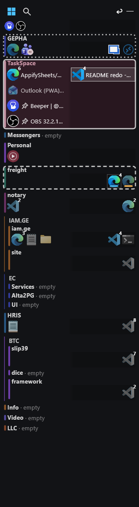</td>
    <td align="center">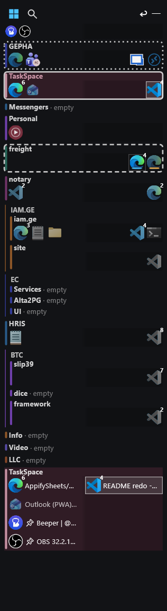</td>
  </tr>
  <tr>
    <td align="center"><em>Expand the current workspace</em></td>
    <td align="center"><em>Window list at the bottom of the bar</em></td>
  </tr>
</table>

**What each icon tells you.**

- The focused window is outlined and filled. A fainter amber outline on another row marks the
  window you would land on if you switched there.
- Icons fade as they recede: full strength in front, dimmer when covered, dimmest when minimised.
- An amber dot means the app flashed its taskbar button at you. Apps that only badge their icon
  (WhatsApp, for one) do not trigger it. Looking at the window clears it.
- A pulsing green ring means the window is playing sound. The ring holds still when Windows'
  animations are off.
- A small number at the top right is a tab count: on browser windows with two or more tabs, and
  on VS Code windows for their editor tabs.
- Several windows with the **same icon** each get a short coloured bar along the bottom, so you
  can tell three Chrome windows apart. The key is the icon's pixels, not the process: an installed
  web app sitting next to its browser has its own icon and gets no bar.
- An icon you have not touched for fifteen minutes starts to lose its colour and is fully grey
  after eight hours. The window you are in never ages. The hover card says "last used 2 h ago".
- A window with no readable icon (an elevated process, say) gets a lettered placeholder.

**Rest on an icon and a card appears** with the window's title, the app and workspace it belongs
to, and, for windows on workspaces you are not looking at, a picture of the window at a quarter
size. That is the point: you can see what is waiting elsewhere without going there. A window on the
workspace you are on is already in front of you, so its card is text alone. The
card waits for the pointer to settle first, using the same delay Windows' own taskbar thumbnails
use, so crossing the bar on the way somewhere else shows nothing. A minimised window has no picture
to show, so its card is text alone.

<p align="center">
  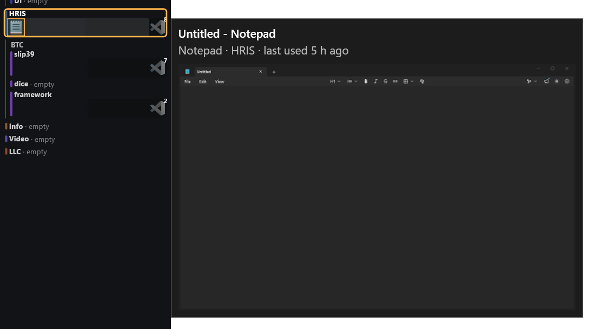
</p>

**Icons keep their order.** Within a row, icons sit in the order their windows were first seen, so
nothing jumps out from under the pointer. Drag an icon along its row to put it where you want; a
thin marker shows where it will land, and the order is saved by app, so it comes back after a
restart.

### Screens

With more than one monitor, each row is divided into one lane per screen, in the order your
screens physically sit (left to right, then down to the next row of them), not in whatever order
Windows numbered them. The first screen's icons start at the left edge; later screens' icons are
pushed to the right, and the second screen's lane is shaded a little darker than the row, so free
space collects in the middle of the row where a click switches workspace. Every row splits at the
same place, so a position on the bar always means "which screen".

The shaded lane is also a **drop target**: drag an icon into the other screen's lane on its own
row and the window moves to that screen, sized proportionally the way `Win+Shift+Arrow` does and
never shrunk. Drop it into the other lane on another workspace's row and it changes workspace and
screen in one gesture. A minimised window moved this way stays minimised and comes up on the new
screen when you next open it. During any drag, a small readout beside the bar says what dropping
here would do: "move to Work, screen 2".

### Clicking, dragging, moving

- **Click an icon** to jump to that window wherever it lives. Click it again, once you are in
  it, to minimise it.
- **Click anywhere else on a row**, the gaps between icons included, to switch to that workspace.
- **Drag an icon to another row** to move the window there. Dragging a background window leaves
  you where you are; dragging the window you are in takes you with it, because sending away the
  thing you are using and staying behind is never what you meant.
- **Drag a window by its own title bar onto a row** and it moves there too, back to its original
  place and size (still maximised if it was). You stay put. Windows' Snap preview may flash while
  you drag; ignore it.
- **Drag either side edge to set the bar's width.** Icons re-wrap as you drag and the width is
  remembered. A busy row wraps onto another line rather than making the whole bar wider.
- **`Ctrl`+drag or middle-drag moves the bar**, from anywhere on it. Drop it within an icon's
  width of a screen edge and it snaps flush. It remembers a position for each monitor arrangement,
  the way Windows 11 does for windows.
- The bar grows and shrinks at its bottom edge; its top stays where you put it.
- **Right-click an icon** for the renaming items (below). **Right-click a row** for everything
  about that workspace. **Right-click empty bar** for the app-wide items: New workspace, docking,
  the window-list toggle, Minimize bar, Manage, Check for updates, any waiting update, and Exit.

<p align="center">
  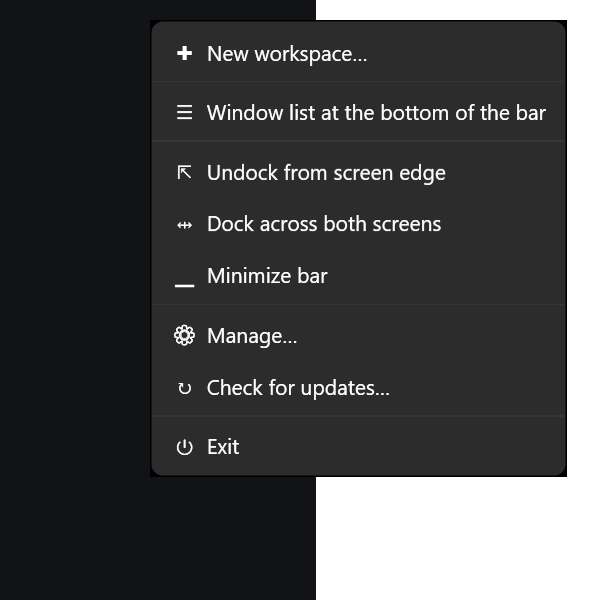
</p>

The bar does not appear in `Alt+Tab` or on the taskbar. It stays bright while you hold the chord,
drag an icon or have one of its menus open; otherwise it holds full strength for ten seconds after
the pointer leaves and then dims over four seconds to 35%. All four of those numbers are sliders
on Manage → Settings. A fully opaque setting means it never dims.

### The workspace row menu

Right-click a row for: **Rename…**; **Insert before…**, **Insert after…** and **Add child…**;
the group items (next section); **Fold row**, which flips to **Unfold row**; the window-list toggle; the colour strip; **Move up**, **Move down**, **Move to top**
and **Move to end**, which work within the row's group; **Delete workspace…**; and the bar items,
**Dock to screen edge**, **Dock across both screens** and **Minimize bar**.

<p align="center">
  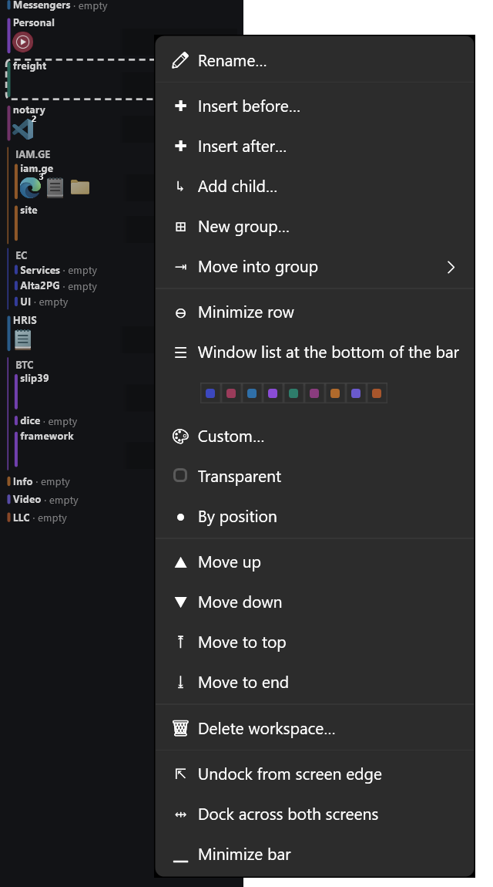
</p>

**Fold row** draws the row as its name alone, for a workspace you are not working in right now. The
name is followed by how many windows it holds, and by the amber attention dot when one of them is
flashing for you, so folding never hides a message. Clicking the name still switches there, and a
window dropped on it still moves there. The workspace you are on always shows its icons, folded or
not; leave it and it folds again.

**Colour.** Nine swatches sit in one strip inside the menu, with the current choice ringed. Below
them, **Custom…** opens Windows' own colour dialog starting on the row's current colour;
**Transparent** opts the row out of tinting; **By position** hands the colour back to the palette.
Palette colours follow *position*, so inserting a row above recolours the rows below it; picking a
colour pins it.

**Delete workspace…** asks first, and the dialog defaults to No. When the workspace still holds
windows it names the apps and closes them with it, the way their own close button would, nothing
killed; if an app refuses to close (an unsaved document, usually) nothing is deleted and it tells
you which one. The alternative, letting Windows delete the desktop, scatters those windows onto a
neighbouring desktop where you find them days later, so this app does not do that.

### Groups

Related workspaces can be grouped. A group has one caption, one colour settable from any of its
rows, and a line drawn down its left edge like a tree. Two kinds exist:

- **Add child…** on a row makes a workspace nested under it. The parent is the group's anchor and
  the group is named after it. A nested workspace really gets its parent's windows: stand in the
  child and the parent's windows are there with it.
- **New group…** on a row, or **Move into group** when groups already exist, makes a plain group:
  a name and a box, nothing borrowed. A plain group has a dim header row with its own menu
  (**Rename group…**, **Ungroup**, **Fold group**, the colour strip, and **Move group up**,
  **Move group down**, **Move group to top** and **Move group to end**, which move the whole group
  past the rows around it).

A row inside a group offers **Fold group '…'**, **Move out of group** and **Ungroup '…'**; the
last names the group because it affects rows other than the one you clicked.

**Fold group** draws the whole group as one line: its name, then each member's name, then how many
windows they hold between them and the attention dot if any of them wants you. Each name on the line
switches to that workspace. The workspace you are on keeps its full row under the line. A folded
group's line has the group's menu, which is where **Unfold group** is. Folding a group leaves each
member's own fold alone, so unfolding it puts every row back the way it was. Leaving a group of two dissolves it.
Ungrouping keeps every desktop, name and position. Deleting an anchor leaves its group as a plain
one.

### Pinned, unnamed and unplaced rows

The **pinned row** sits at the top. Drop an icon on it to pin that window to every desktop so it
follows you everywhere; drag it off onto a workspace row to unpin it. Its caption line holds the
bar's header: **Start** and **Search** buttons on the left, and on the right **↩**, which goes
back to the workspace you were on before this one (the same thing one tap of `Win+Ctrl+Tab` does,
for when your hand is on the mouse), and a minimise button, which puts the bar away.

**Desktops you have not named** appear as their own rows below the workspaces, so nothing on your
machine is missing from the bar. Right-click one for **Name this desktop…**, which also renames it
in Task View so the two agree, or **New workspace…**.

An **Unplaced** row catches windows whose desktop Windows will not report, with a note saying why
each one could not be placed. Apps minimised to the tray do not fall into it; they keep their
workspace and reappear in it when reopened.

### Minimising the bar

**Minimize bar** is on every bar menu, on the tray menu, and behind the minimise button in the
bar's header. The bar goes
away and leaves a taskbar button that is pinned to every desktop; click it, or the tray item that
now reads **Show bar**, to bring the bar back. The X on that button's thumbnail restores the bar;
it does not exit. The state survives a restart.

### Docking

By default the bar floats wherever you drop it. Two other modes exist, both off by default and
both toggled from any bar menu, from the **Dock the bar to the edge of its screen** box in Manage,
or from the command line.

**Dock to screen edge** turns the bar into an app bar on the left or right edge of its screen,
full height with square corners. Windows reserves that strip: maximised windows, Snap and new
windows keep clear of it. The bar cannot be moved while docked (moving the strip would leave the
reservation behind), but its width can still be dragged. A full-screen app takes the bar out of the
topmost band while it runs. Minimising the bar gives the strip back.

**Dock across both screens** straddles the seam between two side-by-side screens: the first
screen's lane sits on the left screen, the second's on the right, each half reserving half the
bar's width, and each half repeating the row's caption and group line so either side reads on its
own. Screens that are not level are handled: the bar spans both strips and its content is inset to
the height the two screens share. Screens with different scaling are not.

<table align="center">
  <tr>
    <td align="center" valign="top">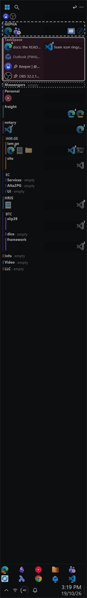</td>
    <td align="center" valign="top">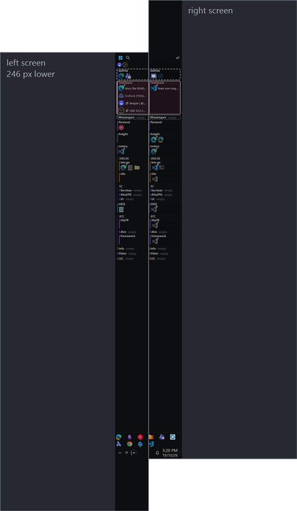</td>
  </tr>
  <tr>
    <td align="center"><em>Docked to one screen's edge</em></td>
    <td align="center"><em>Docked across both screens, which are not level</em></td>
  </tr>
</table>

Compare the floating bar at the top of this page: the same rows, but only as tall as its content,
with rounded corners, wherever you dropped it.

### Taskbar pieces

Docked or not, the bar carries enough of the taskbar that you can leave Windows' own on auto-hide.

- **Pins.** A line showing the taskbar's pinned apps in the taskbar's order. Click one to jump to
  its window in this workspace, or to start it here if it has none. A short bar under a pin means
  it has a window here, a dot means one only elsewhere. Middle-click or `Shift`+click opens a new
  window. Browser pins always open a new window; installed web apps jump to theirs. Right-click
  offers **New window**, **Open file location** and **Unpin from taskbar**. Pinning itself stays
  on the taskbar, because Windows gives other programs no way to pin.
- **Now playing.** While something is playing, a line above the pins shows the player's icon, the
  title, the artist and the app, with previous, play/pause and next. Clicking the title brings the
  player forward.
- **The strip along the bottom.** A tray chevron that opens the hidden icons in one click, quick
  settings (drawn as wifi, plus a battery on a laptop), a volume dial, the notification bell, the
  clock (time over date, in your regional format, with the long date as a tooltip) and a show
  desktop sliver at the very edge. The buttons send Windows' own shortcuts, so each opens the real
  flyout.
- **The volume dial** is a 270° arc. Hover and it grows a knob and shows the percentage; the mouse
  wheel moves it 2% a notch and unmutes. Click it to list your playback devices with the default
  ticked, and **Mute** at the end; choosing a device makes it Windows' default.

<table align="center">
  <tr>
    <td align="center" valign="bottom">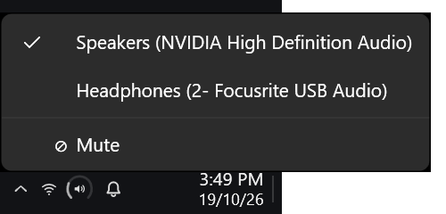</td>
    <td align="center" valign="bottom">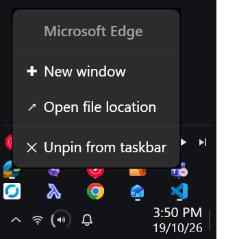</td>
  </tr>
  <tr>
    <td align="center"><em>The volume dial's device menu</em></td>
    <td align="center"><em>A pin's menu</em></td>
  </tr>
</table>

Tray icons are not copied onto the bar, because apps hand them only to Explorer.

## Switching workspaces

Hold `Win+Ctrl` and tap `Tab` to walk your workspaces in **most-recently-used** order; release to
switch. Add `Shift` to walk backwards. One tap therefore returns you to wherever you just were,
however your list is arranged, which is the whole reason `Alt+Tab` is worth using. `Esc` cancels.

While you hold the chord, a short list appears beside the bar showing the walk in order, and on
the bar itself the row you would land on is ringed in amber, with the window that would take
focus there outlined. Nothing switches until you let go, so walking past three workspaces does
not animate three desktop switches.

<p align="center">
  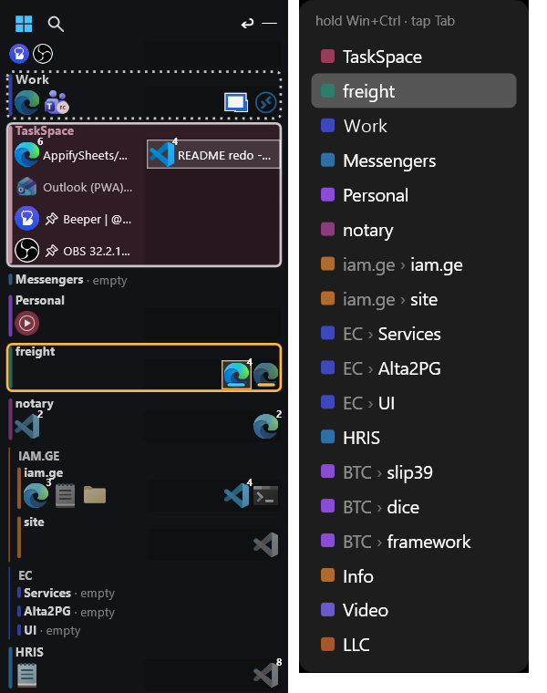
</p>

**You arrive in the window you left.** Landing on a workspace puts focus back on whichever window
had it last time you were there. Somewhere you have not been yet this session gets the front-most
window on your main monitor.

`Win+Ctrl+Tab` was chosen by testing every `*+Tab` chord against Windows: it is the only one with
both its forward and reverse halves free, and it neighbours `Win+Ctrl+←/→`, which Windows already
uses for desktops. Change it on Manage → **Shortcuts**; the new chord is checked as you type and
takes effect at once. Whatever you pick becomes **exclusive** while Deskbar runs, so avoid
chords other apps need (`Ctrl+Tab` would stop reaching browsers, editors and Explorer). It is the
*only* shortcut Deskbar registers; everything else is on the bar, one click away. Key release is
detected by polling while the list is up, not by a keyboard hook, so Deskbar never sits in the
path of your keystrokes.

## Naming windows

Give a window a short name so the taskbar shows `RDP` instead of
`Remote Desktop Manager [server-01 - fhd]`. Right-click an icon for:

- **Rename this window…**, keyed to the exact title the window had at the time. It lapses the
  moment the app rewrites its own title, so prefer the next one for browsers, chat apps and
  editors.
- **Rename all *app* windows…**, keyed to the process. Never lapses.
- **Rename by title pattern…**, matching with `*`: `beeper *` names every Beeper window `beeper`.
- **Name *app* windows by folder**, for apps whose titles say what they hold. One name for every
  window of an editor is the wrong shape: seven VS Code windows all reading `VSC` tell you nothing.
  This names each after the folder, project or session it currently holds, and follows the window
  when you open something else. Offered for VS Code and its forks, Visual Studio, the JetBrains
  IDEs and Remote Desktop Manager. Browsers are left out, because a tab title is the page rather
  than a container.
- **Restore title**, to take a name back.

<p align="center">
  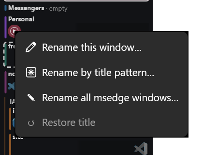
</p>

Names persist across restarts. A titleless window that still wants a taskbar button is shown under
its process name rather than "(untitled)".

## Where windows go

Deskbar never launches anything and never changes a window's size or position on screen. The
one axis it arranges is which desktop a window belongs to, and that it remembers.

- **A workspace remembers which apps belong to it** even when they are closed. That memory is what
  puts a window back where you last had it rather than wherever it opens. Identity is the
  executable plus its arguments, so `rider64 A.sln` and `rider64 B.sln` are different things, and
  an installed web app is a different thing from the browser it runs in.
- **Dragging teaches.** Move a window to a workspace by hand and that is where the app goes next
  time. A window that merely *opened* somewhere teaches nothing until you move it once, because
  where a new window opens is just the desktop you happened to be on, and a wrong rule is worse
  than none. Windows already open when Deskbar starts are learned from where they sit.
- **Some apps stay where they were opened** and are never learned from: browsers, Windows Terminal
  and console windows, Open and Save dialogs, the Windows Security sign-in and Task Manager. A
  browser window says nothing about the work, so one dragged Edge window used to teach that all
  of Edge lived there. Explorer is never remembered either, so `Win+R` opens on the current
  desktop. Installed web apps, the launched-by rule and hand-written rules still apply to them.
- **Folders get their own memory.** Several windows of one editor are a single app as far as the
  roster is concerned, so a reboot used to pile every editor window into one workspace. Where a
  window's *folder* lives is remembered separately: open that folder again, anywhere, and the
  window goes to its own workspace. It learns from where your windows sit once a position has held
  still, including moves made with Task View or `Win+Ctrl+←/→`, and from anything you drag.
  Deleting a workspace forgets the folders that lived in it.
- **A window opened by another app joins that app's workspace.** Click a link in your editor and
  the browser window it opens lands beside the editor rather than wherever you are standing. It
  follows the process chain to whoever really started it, and where that app has windows in
  several workspaces, the one you were last in wins. Explorer and the shell never count as the
  launcher, so things started from the taskbar are unaffected. This is an inference about one
  window: it moves the window and teaches the roster nothing.
- **When several windows of one app are already open, a new one is left where you opened it.**
  Four browser windows on one profile are one identity, so "put it back" has no single answer.
- **Rules**, on Manage → Rules, assign windows you have never placed, by process name, title regex
  or browser profile, and hold the title-pattern renames.
- **Remote Desktop Manager** session windows go to their own workspace, and tabbed apps get one
  placement check per window, so a dashboard does not jump between workspaces.
- An **automated browser** (one a tool started with its own `--user-data-dir`) is placed by the
  launched-by rule, so it lands beside the tool that started it.

## Manage

Left-click the tray icon. Five tabs:

- **Workspaces** adds, renames, removes and reorders them (that order is the bar's row order), and
  nests one under another. Beside the list, **Apps that belong to this workspace** shows the
  roster, each entry as the exe plus the last title when they differ, with **Remove from this
  workspace** to forget a placement. Removing an entry never touches a running window; move the
  app back by hand and a new entry is written. Remove on a workspace here does not close its
  windows; the bar's **Delete workspace…** does.
- **Shortcuts** rebinds the one chord.
- **Time** reports how long you have spent in each workspace today, this week (since Monday) and
  over the last thirty days, by group and by workspace, sortable. Only input counts, keyboard or
  mouse; two minutes without either is idle, so a workspace left on screen overnight accrues
  nothing, and a machine that slept is not credited for the gap. It is counted in fifteen-second
  slices.
- **Settings** holds the bar's five dials: how faint it goes once the pointer is elsewhere, how
  long it waits before starting to dim, how long the dimming takes, how long the pointer has
  to rest on an icon before the card appears, and the size of the bar's text, in half points, all
  of it moving together. Each applies as you drag the slider, so you choose by
  looking, and there is nothing to save. The hover delay follows Windows' own setting unless you
  untick the box and pick your own.
- **Rules** holds the auto-assignment and renaming patterns.

Below the tabs sit the three machine-level settings: **Dock the bar to the edge of its screen**,
**Start Deskbar with Windows**, and **Check GitHub for new versions**, with the version you are
running at the bottom right.

<p align="center">
  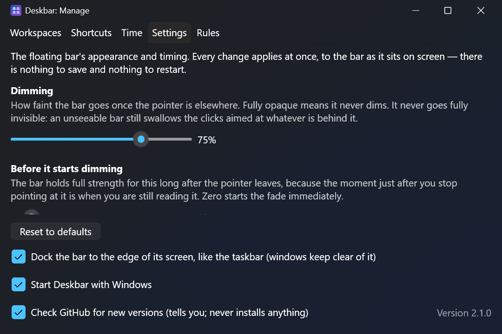
</p>
<p align="center">
  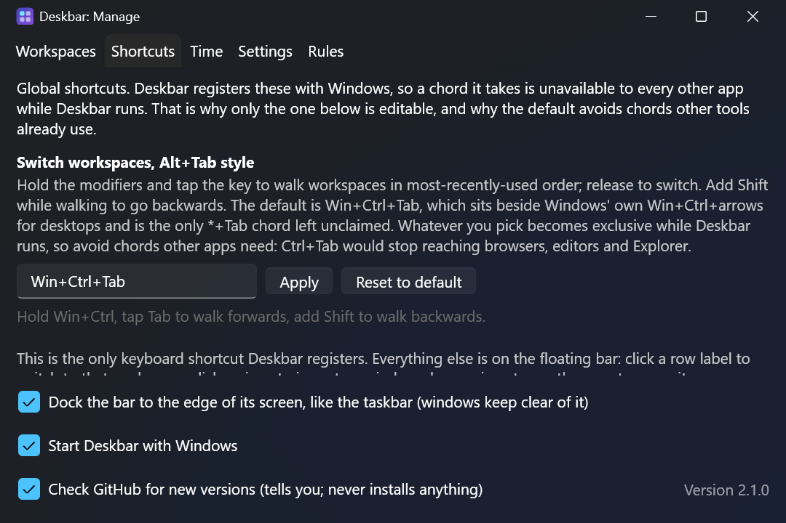
</p>

## Updates

Every five minutes Deskbar asks GitHub whether a newer release exists (a release whose exe is
still being built is ignored until it is ready). When one appears you are asked once, in a small
window of the app's own: "Update Deskbar to 1.28.0?". Say no and an **Update to …** item stays
on the tray and bar menus until you are on that version. Only the newest offer is ever shown.

Accepting downloads the new exe **next to the one you are running**, never over it, through a
`.part` file renamed only when complete, with a progress window showing the real percentage; then
the new copy starts and the old one exits, and "Start with Windows" is re-pointed at the new file.
The previous exe stays on disk, so if you dislike the new version you can go back one step. When the
new version starts it removes the `Deskbar-<version>-win-x64.exe` files beside it that are older than
that previous one.
Downloads are https only, from github.com or githubusercontent.com.

**Check for updates…** on the tray and bar menus asks immediately and always answers: you are on
the latest, a newer one exists, the download is still being built, or the check failed and here
is the releases page. The checkbox at the bottom of Manage governs only the automatic check; a
manual check still contacts GitHub, because clicking it is the request. Unticking takes effect at
the next start. The check is the app's only network traffic.

Why a window rather than a Windows notification: a portable exe with no Start-menu shortcut has no
AppUserModelID, and Windows silently drops its toasts. Registering one would cost the "one file,
nothing installed" property, so the app asks in its own window.

## Driving it from scripts

While Deskbar runs it keeps a small batch file at `%APPDATA%\Deskbar\deskbar.cmd` that
hands a command to the running copy. A coding agent that has just set up a git worktree can give
it a workspace of its own and move the editor there:

```powershell
& "$env:APPDATA\Deskbar\deskbar.cmd" move wt-login --create --group EC --title wt-login --wait 20
```

Everything the bar's menus do has a command, and each one runs the same code as its menu item.
`help` prints the list from the running copy, so it always matches the version you have:

| Group | Commands |
|---|---|
| Listing (JSON) | `workspaces`, `windows`, `desktops` |
| Workspaces | `create <name> [placement]`, `rename`, `add-child`, `reorder <ws> up\|down\|top\|end\|<n>`, `fold`, `unfold`, `color <ws> <colour>`, `delete <ws> [--close-windows]`, `switch` |
| Groups | `group-create`, `group-join`, `group-leave`, `group-rename`, `group-color`, `group-fold`, `group-unfold`, `group-reorder <group> up\|down\|top\|end\|<n>`, `ungroup` |
| Desktops | `name-desktop <id or number> <name>` |
| Starting | `start <ws> [--create [placement]] [--cwd <folder>] -- <program> [arguments...]` |
| Windows | `move <ws> [--create [placement]] [--no-follow] (--title <text> \| --hwnd <h>)...`, `rename-window`, `rename-app`, `rename-pattern`, `name-by-folder <hwnd> on\|off`, `restore-title`, `pin`, `unpin` |
| Bar | `bar minimize\|restore\|dock\|undock\|across\|edge` |

A few more, with `$ts` standing for the batch file:

```powershell
$ts = "$env:APPDATA\Deskbar\deskbar.cmd"
& $ts workspaces                          # JSON: name, group, row, colour, minimized, current
& $ts create Review --after Services      # beside Services, inside its group
& $ts reorder Review end                  # to the bottom of its group
& $ts group-leave Review                  # out of the group
& $ts color Review teal                   # a palette name, #RRGGBB, none or default
& $ts move Review --hwnd 0x51107A --no-follow
& $ts bar across                          # dock across both screens
& $ts delete Review                       # refused while it still has windows
```

A new workspace goes at the end of the bar unless you say where: `--group <group>` puts it at the
bottom of that group, `--position <n>` at row n counting a whole group as one row, and `--before`
or `--after <workspace>` work like the menu's Insert items. `create` is not an error when the
workspace already exists.

`move <workspace>` picks windows with `--title <text>`, which also searches the title a window had
before Deskbar shortened it, or with `--hwnd <handle>` taken from `windows`. A move is all or
nothing: when any selector finds no window, nothing moves and the exit code is 3. `--wait <s>`
keeps retrying that case, which covers an editor that is still opening. Moving the window you are
in takes you along, as a drag on the bar does; add `--no-follow` to stay put, which you want for a
window a script has just opened, because that window has focus.

`start <workspace> -- <program> [arguments...]` starts a program and puts its window in that workspace as it
opens, without taking you along. Windows opens every new window on the desktop in front, so this is not a
move you have to make afterwards, but it is still a move: Deskbar claims the window the moment it appears,
which on a measured run was half a second after the command, with the window on your current workspace for
part of that. It claims every window of the started process and the processes it starts for 30 seconds, plus
the first new window with the same exe name, which covers a browser or editor that hands the request to a
copy already running. Everything after `--` is the program's own command line. `--cwd <folder>` sets the
folder it starts in, since the running app cannot see yours. Deskbar never starts anything on its own.

```powershell
& $ts start wt-login --create --group EC --cwd C:\src\login -- code .
& $ts start Research -- chrome --new-window https://example.com
```

`delete` closes nothing unless you add `--close-windows`. The menu asks before closing; a command
cannot ask, so you have to say it. Manage, Check for updates and Exit deliberately have no
command.

The batch file exists because PowerShell does not wait for a windowed program it calls directly,
so it would get no output and no exit code. From Git Bash or cmd you can also call the exe itself
with `ctl <command>`. The client passes arguments through verbatim, so it does not have to match
the app's version. Exit codes: 0 done, 1 refused, 2 Deskbar is not running, 3 no window
matched.

## Why this matters

Switching between projects is expensive, and the expensive part is not the switch. It is
**rebuilding the context you had before**. Here is what the research says about that, including
the parts that argue against this app.

### The unit people think in is the project, not the window

[González and Mark](https://dl.acm.org/doi/10.1145/985692.985707) followed analysts, developers
and managers through their working days and found that people organise work into **"working
spheres"**: thematically connected units, each with its own documents, tools and people. Workers
spent roughly **three minutes on a single event** before switching, and a little over two minutes
on any one document or tool.

A taskbar shows you windows. Your head is organised by spheres. That mismatch is the gap. Mark's
later work found the fragmentation getting finer still: average time on a single screen fell from
about **2.5 minutes in 2004 to roughly 47 seconds**.

### Resuming is the costly half, and it is mostly searching

The most directly relevant study is
[Parnin and Rugaber's](https://link.springer.com/article/10.1007/s11219-010-9104-9) analysis of
**10,000 recorded programming sessions from 86 developers**, plus a survey of 414 more. Two numbers
stand out:

- only **10%** of sessions resume programming activity within a minute of an interruption;
- only **7%** involve *no* navigation to other locations before editing resumes.

After a switch, most of the time goes on re-finding things rather than doing the work. That is the
cost a workspace tool can attack.

### Your windows are external memory, not clutter

The same study names the strategy developers invent for themselves, **cue priming**: deliberately
leaving the last edited window open, or highlighting the relevant lines, so that returning to the
task triggers recall.

This is the crux of the argument. **A window arrangement is externalised mental state.** Every
open window is a deliberate cue about where you were. Anything that scatters the arrangement
destroys the cue, and anything that preserves it preserves the context for free. Deskbar does
not help you rebuild context; it stops the context being demolished.

Which is why it never changes a window's size or where it sits on screen. It does not tile, snap
or lay anything out, and it opens nothing for you. It arranges your windows along one axis only,
which desktop each belongs to, and that much it remembers and puts back.

### Which is what virtual desktops were invented for, in 1986

[Henderson and Card](https://dl.acm.org/doi/10.1145/24054.24056) built *Rooms* at Xerox PARC to
attack what they named **"window thrashing"**: the state where the screen is too small for the
work, so the user "must expend considerable effort to keep desired windows visible". Their fix was
multiple virtual workspaces, exploiting the fact that window access clusters by task.

Forty years on, Windows ships virtual desktops that solve the *space* problem and barely touch the
*context* problem: no visible names, no memory of what belongs where, and nothing survives a
reboot. Existing tools each cover a slice (PowerToys Workspaces relaunches layouts, Groupy tabs
windows, TaskbarGroups groups shortcuts), but none does *live context switching with persistence*.

### Attention residue: why unfinished work keeps charging you

[Leroy](https://ideas.repec.org/a/eee/jobhdp/v109y2009i2p168-181.html) found that when people
switch tasks, part of their attention stays with the previous one, and they perform measurably
worse on the new task as a result. The effect is strongest when the previous task was
**unfinished**, time-pressured or emotionally engaging, and it does not fade after a moment's
adjustment.

Fifteen taskbar buttons from four projects are fifteen reminders of things you have not finished.
Stated plainly: Leroy studied cognitive residue, not taskbars. That visible unfinished work
sustains residue is a reasonable inference, not a measured finding.

### How that maps onto what the app does

| The research says | What Deskbar does |
|---|---|
| Work is organised in *spheres*, not windows | Workspaces are named, first-class things you switch between |
| Only 10% of resumptions are fast; the rest are re-finding | A switch restores an entire context at once, with nothing to re-find |
| People leave windows open as recall cues | The cue *is* the workspace, preserved and persisted |
| Window thrashing wastes effort keeping the right windows visible | Other contexts' windows are on another desktop, natively filtered out of the taskbar |
| Unfinished work stays costly while it is in view | Other projects are out of sight, not merely minimised |
| Fragmentation is getting finer | A switch is `Win+Ctrl+Tab`, or one click on the bar |

And the features that exist because manual organisation decays the moment it needs upkeep:
**placement memory** (where you last put a window is where it goes next time, keyed to what the
app *is* rather than to a window handle), **rosters** (a workspace remembers which apps belong to
it even when they are closed, which is what makes that memory outlive any single window), and
**renaming** (`RDP` is parsed faster than `Remote Desktop Manager [server-01 - fhd]`, and
retrieval cues work better when they are legible).

### Agentic AI multiplies the contexts, it does not replace them

One thing has changed the shape of a working day faster than any of the research above
anticipated. Supervising coding agents is not one task in one editor. Each agent you have running
wants its own editor window, its own terminal, its own browser tabs, often its own running copy of
the thing under test, and each of those clusters is a context you step into while another agent
works and step out of when it needs you. The agent does the typing; the supervising, reviewing
and deciding still happen in your head, and they happen **several times over, concurrently**.

That is the same working-sphere problem as before, at a count nobody used to reach. Three projects
on the go was a busy day; three agents on one project plus two on another is an ordinary
afternoon, and the windows do not stay tidy on their own. Virtual desktops are the right container
for it, one per line of work, which is why this app puts effort where that count starts to hurt:
every desktop's windows visible at once, most-recently-used switching for the two you are
alternating between, groups for related lines of work, memory of where each window belongs so a
restart does not scatter them, and a command line so the agent can set up its own workspace.

### Who it is for, and who it is not

The benefit scales with **how many unrelated contexts you hold at once**, not with how hard you
work: several projects with distinct toolchains, switching on someone else's schedule, work and
personal life on one machine, contexts that live for days.

If you work on one thing at a time and close it when you are done, this solves a problem you do
not have.

### Where the argument is weak

1. **Cheaper switching is not less switching.** The research suggests *frequency* drives the
   stress. This lowers the cost per switch and may even encourage more of them.
2. **No study measures Deskbar.** Everything above is adjacent research on interruption,
   resumption and window management; the step from "resumption is mostly re-finding" to
   "therefore this helps" is mechanism-level reasoning, not evidence about this product.
3. **Windows already provides the mechanism.** The claim is not that this invents context
   isolation, only that it makes it nameable, persistent and automatic.
4. **The AI argument is an observation, not a finding.** Every other claim above rests on a
   published study. That one rests on how this app's own author works, and it is new enough that
   nobody has measured it. Read it as a description of a workload, not as evidence.

### Sources

- Victor M. González and Gloria Mark, ["Constant, constant, multi-tasking craziness": Managing multiple working spheres](https://dl.acm.org/doi/10.1145/985692.985707), CHI 2004. Working spheres, and the ~3-minutes-per-event figure.
- Gloria Mark, Victor M. González and Justin Harris, [No Task Left Behind? Examining the Nature of Fragmented Work](https://ics.uci.edu/~gmark/CHI2005.pdf), CHI 2005. The fragmentation of knowledge work.
- Gloria Mark, *Attention Span* (Hanover Square Press, 2023). The 2.5-minutes-to-47-seconds figure.
- Chris Parnin and Spencer Rugaber, [Resumption strategies for interrupted programming tasks](https://link.springer.com/article/10.1007/s11219-010-9104-9), Software Quality Journal 19(1), 2011 ([PDF](http://www.chrisparnin.me/pdf/parnin-sqj11.pdf)). The 10% and 7% resumption figures, and cue priming.
- D. Austin Henderson and Stuart K. Card, [Rooms: the use of multiple virtual workspaces to reduce space contention in a window-based graphical user interface](https://dl.acm.org/doi/10.1145/24054.24056), ACM Transactions on Graphics 5(3), 1986 ([PDF](http://rivcons.com/wp-content/uploads/1987/Rooms-TOG.pdf)). Window thrashing.
- Sophie Leroy, [Why is it so hard to do my work? The challenge of attention residue when switching between work tasks](https://ideas.repec.org/a/eee/jobhdp/v109y2009i2p168-181.html), Organizational Behavior and Human Decision Processes 109(2), 2009. Attention residue.

## How it works

- Each workspace is backed by a real Windows virtual desktop, so taskbar filtering is native, with
  no shell hacks, and a crash can never lose a window. Hiding windows with `ShowWindow` was
  considered and rejected for exactly that reason: a hidden window can be orphaned by a crash, a
  window on a virtual desktop cannot.
- The bar is an ordinary top-level window that reclaims "always on top" on every foreground
  change and once a second, because the taskbar and the Start menu are topmost windows too and a
  second click on the taskbar changes no foreground window.
- Window lifecycle comes from WinEvent hooks, with a five-second sweep that repairs what the hooks
  drop under load. Those events can only ever lose windows, never invent them, so the sweep
  checks the real window handles rather than trusting the list.
- Where a window belongs is remembered by **what it is**, not by its window handle: executable
  path plus arguments, with Chromium's `--profile-directory` and `--app-id` folded in so an
  installed web app is not its browser. Firefox is deliberately not keyed by profile, because it
  has no profile flag and every window would collapse into one identity.
- The ordinal colour band keys on a hash of the icon's pixels. Process name, the command line's
  app id and the window's AppUserModelID were each tried first and each measured wrong on real
  windows; the picture is the one thing two identical-looking windows reliably share.
- Tab counts come from UI Automation on a background thread, refreshed at most every four seconds
  unless the title changed.
- Docking uses the shell's app bar registration (`SHAppBarMessage`), the same mechanism the taskbar
  uses to reserve its strip.
- The volume dial talks to Core Audio; choosing a playback device goes through the undocumented
  `IPolicyConfig`, which is the only way to set Windows' default device from a program. The pins
  line reads the taskbar's own pinned list from the registry and never writes it.
- **Other programs ask the running copy rather than touching anything themselves.** The app owns
  `state.json`, the virtual desktops and the window list, so a second process editing any of them
  would race it. It listens on a named pipe only your own Windows account can open, per session;
  `deskbar.cmd`, or the exe started with `ctl`, sends one command and prints the answer.
  Commands run on the app's UI thread through the same code the bar's menus use.
- Everything is persisted, so your workspaces, groups, window names, colours, icon order, the
  bar's width, position and settings, and your shortcut survive both an app restart and a reboot.

### Diagnostics

Three traces (clicks, row geometry, icon sources) sit behind one switch: create the empty marker
file `%APPDATA%\Deskbar\trace.on` (or set `DESKBAR_TRACE=1`) and restart. The log is
`%TEMP%\deskbar-trace.log`, appended across restarts; its first line names which switch turned
it on. The geometry and icon traces write only when their output changes, so the file stays
readable with tracing left on all day. Off by default, and off means nothing touches disk.

## Licence

The source is available under the [PolyForm Strict License 1.0.0](LICENSE): you may read
it, build it and run it for noncommercial purposes, and you may not distribute it or
publish changed versions. Contributions are welcome under the extra permission in
[CONTRIBUTING.md](CONTRIBUTING.md). This is source-available software, not open source.

## Tech

C# / .NET 10, WPF tray application (Fluent theming, follows your system light and dark mode),
the Windows virtual desktop COM API via Slions.VirtualDesktop, WinEvent hooks plus System.Reactive
for window lifecycle, H.NotifyIcon for the tray, UI Automation for tab counts, Core Audio for the
volume dial, WinRT `Windows.Media.Control` for now-playing, and CSharpFunctionalExtensions for
railway-style error handling.

The domain is deliberately COM-free and heavily unit-tested: about a thousand test methods across
two projects, the great majority in `Deskbar.Core.Tests` and running without touching Windows
at all. Most of the rest construct real WPF windows on an STA thread per test. Nine carry
`Category=Integration`: they create, switch and delete real virtual desktops, activate real
windows, or call github.com, and they are excluded from the routine run below.

## Development

```powershell
dotnet build Deskbar.sln
dotnet test Deskbar.sln --filter "Category!=Integration"
```

The `Category=Integration` tests are excluded from that command on purpose: they create, switch
and delete **real** virtual desktops on the machine running them. Run them deliberately, not
while you are working.

The C# namespaces, project files and `Deskbar.sln` keep their old names on purpose, so the
commands above are unchanged. Until 2.0 is on main, run a Debug build on a machine that still
runs TaskSpaces 1.x with the environment variable `DESKBAR_APPDATA` set to a scratch folder,
given as a full path (a relative one is ignored). Otherwise its first start migrates your real
profile. With it set, Deskbar reads and writes under that folder instead of `%APPDATA%`, and the
migration touches no registry value. Leave "Start with Windows" alone in a Debug build run under
the override, since that checkbox still writes the real value. Set the variable in the shell you
start the build from (`$env:DESKBAR_APPDATA = 'C:\scratch\deskbar'` in PowerShell), not with
`setx`: setx makes it permanent for every Deskbar started afterwards, a real one at login
included, and does not reach a shell that is already open. The override does not let the two
run together either: the check for a running 1.x does not follow it, so exit TaskSpaces from its
tray icon before starting the Debug build.

### Releasing

Releases are signed with a code signing certificate whose key lives on a hardware token, so
the last steps happen on one machine and not in CI.

Before the first signed release:

- `gh` is installed and authenticated with write access to the repository.
- signtool from the Windows SDK is installed, or `$env:SIGNTOOL` points at one.
- The certificate's USB token and its driver are set up, with the certificate in
  `Cert:\CurrentUser\My`. The thumbprint is the certificate's Thumbprint in
  `Get-ChildItem Cert:\CurrentUser\My -CodeSigningCert`.
- Enforcement is switched on with `gh variable set SIGNING_CERT_THUMBPRINT --body <thumbprint>`.
  Renewing the certificate changes the thumbprint, so update the variable before the next
  release, or every release reverts.
- One rehearsal on a throwaway version, for example 0.0.2. The workflow only builds the
  version that `VersionPrefix` names, so run it from a throwaway branch with `VersionPrefix`
  set to 0.0.2 (`gh workflow run Release --ref <branch> -f version=0.0.2`). Mark the draft a
  prerelease (`gh release edit v0.0.2 --prerelease`) so it never becomes latest, sign and
  publish it with the script, and confirm the guard passes. Then build a second throwaway
  version the same way, mark it a prerelease too, publish it unsigned by hand and confirm the
  guard reverts it. Delete both with `gh release delete vX --yes --cleanup-tag`, and the
  branch with them.

1. Bump `VersionPrefix` in `Directory.Build.props` in the pull request that earns the
   version. Give the PR description a `## Release notes` section written for the people
   updating: the release takes its notes from that section, up to the next `##` heading.
2. Merge it. The merge starts the Release workflow by itself: it builds the version
   `VersionPrefix` now names and creates release `vx.y.z` with an unsigned exe, named
   `Deskbar-x.y.z-win-x64.exe`, so `Deskbar-2.0.0-win-x64.exe` for 2.0.0. A merge that
   touches `Directory.Build.props` without bumping the version releases nothing. To build a
   version by hand instead, for example to retry a failed run, open Actions, pick Release,
   choose Run workflow and enter the version as `x.y.z`, with no leading `v`; it has to match
   `VersionPrefix` at that commit, and it always stops at a draft.
3. On the signing machine, with the token plugged in, run
   `scripts/sign-release.ps1 -Tag vx.y.z -Thumbprint <thumbprint>`, for 2.0.0
   `scripts/sign-release.ps1 -Tag v2.0.0 -Thumbprint <thumbprint>`. The token's driver
   prompts for its PIN. The script signs, verifies, uploads and publishes. `-TimestampUrl`
   overrides the timestamp server, and `-NoPublish` uploads the signed exe and leaves the
   release a draft. If an upload or the publish fails, the script keeps the signed files and
   prints where they are and how to finish.
4. The guard job in the Release workflow runs when the release is published. It checks the
   published assets and reverts the release to a draft if anything is unsigned, or if no
   executable is attached.

After a revert the release is a draft again: fix the cause and re-run the script.

Until the certificate exists, the repository variable `SIGNING_CERT_THUMBPRINT` is unset and
step 3 does not happen: the workflow run that the merge started publishes the release itself,
after checking that an executable is attached (the guard does not run for a release the
workflow publishes with its own token, so that check is made there instead). A draft built by
hand is published with `gh release edit vx.y.z --draft=false`, and the guard then only checks
that an executable is attached. Setting the variable switches signing enforcement on, and a
merge's release then waits as a draft for step 3.

GitHub runs a release event from the workflow file at the tag's commit, so the guard only
covers releases whose tag's commit carries this workflow. Never re-publish a release whose
commit does not, which includes every release made before the guard existed: that commit's
own workflow runs instead, rebuilds the exe and replaces the release's asset with an
unsigned one, and nothing reverts it.

